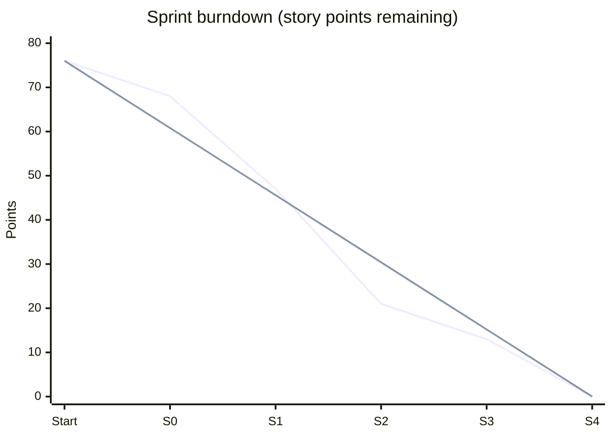
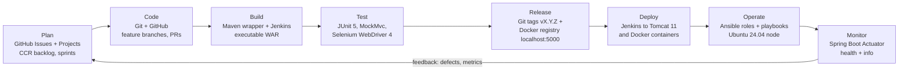
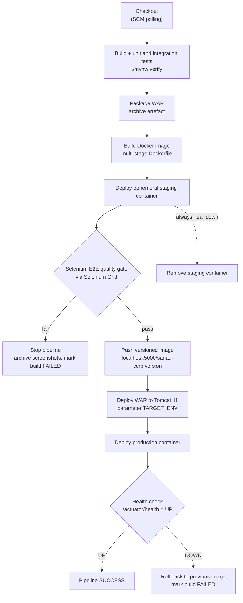
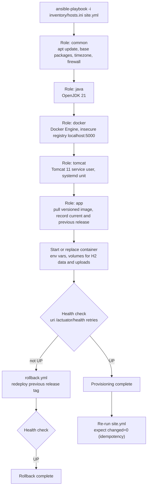

# Agile Plan and DevOps Workflow — Sanad CCRP

| Field | Value |
|---|---|
| Document ID | CCRP-DOC-02 |
| Title | Agile Plan, Product Backlog and DevOps Workflow |
| Version | 1.0 |
| Status | Approved |
| Owner | Tanishq |
| Related phase | Phase 2 — Agile planning and DevOps workflow |
| Last updated | 2026-10-11 |

## Table of contents

1. [Approach](#1-approach)
2. [Team roles and ceremonies](#2-team-roles-and-ceremonies)
3. [Epics](#3-epics)
4. [User stories and acceptance criteria](#4-user-stories-and-acceptance-criteria)
5. [Product backlog](#5-product-backlog)
6. [Sprint plan](#6-sprint-plan)
7. [Velocity and burndown](#7-velocity-and-burndown)
8. [Kanban board snapshot](#8-kanban-board-snapshot)
9. [Definition of Ready](#9-definition-of-ready)
10. [Definition of Done](#10-definition-of-done)
11. [Branching and commit conventions](#11-branching-and-commit-conventions)
12. [DevOps lifecycle](#12-devops-lifecycle)
13. [CI/CD pipeline](#13-cicd-pipeline)
14. [Ansible provisioning flow](#14-ansible-provisioning-flow)

---

## 1. Approach

- **Framework:** Scrum with a Kanban board for flow visibility (Scrumban).
- **Cadence:** 1-week sprints, Monday to Friday, five sprints from 2026-09-07 to 2026-10-09.
- **Estimation:** Story points on the Fibonacci scale (1, 2, 3, 5, 8, 13), relative to CCR-1 (3 points) as the reference story.
- **Prioritisation:** MoSCoW (Must / Should / Could / Won't).
- **Tracking:** GitHub Issues (one issue per story, key `CCR-<n>`) on a GitHub Projects board. The backlog is also exported as [`agile/backlog.csv`](agile/backlog.csv) for import into GitHub Projects or Jira.
- **Traceability:** Branch name, commit messages and PR title reference the issue key, e.g. `feature/CCR-5-document-upload`, `feat(upload): verify magic bytes (CCR-5)`.

## 2. Team roles and ceremonies

This is a **solo project**. One person (Tanishq) performs all Scrum roles. To keep this honest and still useful, each role is time-boxed and has an explicit output.

| Role | Held by | Responsibilities in practice |
|---|---|---|
| Product Owner | Tanishq | Owns and orders the backlog, writes acceptance criteria, accepts stories against the DoD |
| Scrum Master | Tanishq | Keeps the cadence, maintains WIP limits, records impediments and retrospective actions |
| Developer | Tanishq | Implements, tests, reviews own PRs against the PR checklist after a cooling-off period |
| DevOps engineer | Tanishq | Owns Jenkins, Docker, registry, Ansible and environments |
| Faculty guide | Faculty guide | Acts as external stakeholder at sprint reviews; provides phase feedback |

| Ceremony | When | Time-box | Output |
|---|---|---|---|
| Sprint planning | Monday, start of sprint | 30 min | Sprint goal, committed stories, tasks on board |
| Daily check-in | Each working day | 10 min (written) | Short log: done / next / blockers in the sprint issue |
| Backlog refinement | Wednesday | 20 min | Upcoming stories meet the Definition of Ready |
| Sprint review | Friday | 20 min | Demo of increment; evidence captured in `docs/evidence` |
| Retrospective | Friday | 15 min | One to three improvement actions carried into next sprint |

Limitations acknowledged: with no second developer, peer review is replaced by a self-review checklist plus automated gates (tests, Selenium quality gate, pipeline). Estimates are calibrated against one person's velocity only.

## 3. Epics

| Epic | Name | Goal | Stories |
|---|---|---|---|
| EP-1 | Citizen services | A citizen can apply online with a validated document, receive a tracking ID and follow status | CCR-2, CCR-3, CCR-4, CCR-5, CCR-6, CCR-7 |
| EP-2 | Officer workflow | An officer can authenticate, triage a queue, decide applications, issue verifiable certificates with a full audit trail | CCR-8, CCR-9, CCR-10, CCR-11, CCR-12 |
| EP-3 | Platform & DevOps | The product is built, tested, packaged, deployed, provisioned and monitored automatically | CCR-1, CCR-13, CCR-14, CCR-15 |

## 4. User stories and acceptance criteria

### CCR-1 — Repository & project skeleton
**Epic:** EP-3 | **Priority:** Must | **Points:** 3

As a **developer**, I want a version-controlled Spring Boot project skeleton with a reproducible build, so that every subsequent feature starts from a consistent, buildable base.

- **Given** a fresh clone, **when** I run `./mvnw verify`, **then** the build succeeds on Java 21 and produces an executable WAR.
- **Given** the application starts, **when** Flyway runs, **then** the baseline migration is applied to the H2 file database in PostgreSQL mode.
- **Given** the repository, **when** I open a pull request, **then** the PR template and `.gitignore` are present and no build artefacts or secrets are tracked.

### CCR-2 — Design system & UI shell (grainy gradients, liquid glass, theming)
**Epic:** EP-1 | **Priority:** Should | **Points:** 5

As a **citizen**, I want a clean, consistent and readable interface, so that I can complete tasks without confusion on any device.

- **Given** any page, **when** it renders, **then** it uses the shared layout with header, navigation, grainy gradient background and liquid-glass surface components.
- **Given** I toggle the theme, **when** I reload the page, **then** my light/dark preference persists and system preference is used by default.
- **Given** a 360 px-wide viewport, **when** I view any page, **then** there is no horizontal scrolling and text contrast meets WCAG AA.

### CCR-3 — Certificate request submission form
**Epic:** EP-1 | **Priority:** Must | **Points:** 5

As a **citizen**, I want to fill an online application for a BIRTH, INCOME, DOMICILE or MARRIAGE certificate, so that I do not need to visit the office to apply.

- **Given** I open the apply page, **when** I choose a certificate type, **then** the form shows the common fields and the type-specific fields (annual income for INCOME, spouse name for MARRIAGE).
- **Given** I submit a complete valid form, **when** the server accepts it, **then** an application is persisted with status SUBMITTED.
- **Given** I submit an invalid form, **when** the page re-renders, **then** my entered values are retained and errors are shown next to each field.

### CCR-4 — Applicant data validation
**Epic:** EP-1 | **Priority:** Must | **Points:** 5

As an **officer**, I want every application validated on the server before it reaches me, so that I only review complete and well-formed data.

- **Given** a name outside 3–100 characters or containing characters other than letters, spaces, `.`, `'` or `-`, **when** I submit, **then** the name is rejected.
- **Given** a date of birth in the future or implying age above 120, or an invalid email, or a mobile not matching 10 digits starting 6–9, or a PIN not matching 6 digits without a leading 0, **when** I submit, **then** the corresponding field error is shown.
- **Given** a 12-digit national ID that fails the Verhoeff checksum, **when** I submit, **then** it is rejected with a checksum error.
- **Given** type INCOME without an annual income between 0 and 1,00,00,000, or type MARRIAGE without a spouse name, or a purpose outside 10–300 characters, **when** I submit, **then** the submission is rejected.

### CCR-5 — Supporting document upload & validation
**Epic:** EP-1 | **Priority:** Must | **Points:** 5

As a **citizen**, I want to upload one supporting document with my application, so that the officer has the evidence needed without a physical visit.

- **Given** no file is attached, **when** I submit, **then** the submission is rejected with "document required".
- **Given** a file larger than 2 MB, **when** I submit, **then** it is rejected with a size error.
- **Given** a file whose content is not PDF, PNG or JPEG by magic bytes (for example a renamed `.exe` with `.pdf` extension), **when** I submit, **then** it is rejected.
- **Given** a valid file, **when** the application is saved, **then** the file is stored outside the web root and its SHA-256 hash, media type and size are recorded.

### CCR-6 — Tracking ID generation & acknowledgement
**Epic:** EP-1 | **Priority:** Must | **Points:** 3

As a **citizen**, I want a unique tracking ID and an acknowledgement after submitting, so that I have proof of submission and a reference for follow-up.

- **Given** a successful submission, **when** the acknowledgement page loads, **then** it shows a tracking ID matching `CCR-2026-[A-Z0-9]{6}` (unambiguous base32-style alphabet), type, and submission time.
- **Given** many submissions, **when** IDs are generated, **then** each is unique (enforced by a database unique constraint with retry on collision).
- **Given** the acknowledgement page, **when** I refresh it, **then** the application is not submitted twice (Post/Redirect/Get).

### CCR-7 — Status tracking with timeline
**Epic:** EP-1 | **Priority:** Must | **Points:** 3

As a **citizen**, I want to look up my application by tracking ID and see its status history, so that I know where it stands without calling or visiting.

- **Given** a valid tracking ID, **when** I search, **then** I see the current status and a timeline of each status change with timestamp.
- **Given** an unknown or malformed tracking ID, **when** I search, **then** I see a neutral "not found" message that does not reveal other applications.
- **Given** a REJECTED application, **when** I view it, **then** the rejection reason is shown; **given** an APPROVED one, **then** a link to the certificate is shown.

### CCR-8 — Officer authentication
**Epic:** EP-2 | **Priority:** Must | **Points:** 3

As an **officer**, I want to log in securely, so that only authorised staff can view and decide applications.

- **Given** I am not logged in, **when** I request any `/officer/**` page, **then** I am redirected to the login page.
- **Given** valid seeded credentials, **when** I log in, **then** I land on the review queue; **given** invalid credentials, **then** a generic error is shown.
- **Given** I am logged in, **when** I log out, **then** my session is invalidated and protected pages are no longer accessible. Passwords are stored as BCrypt hashes and forms are CSRF-protected.

### CCR-9 — Officer review queue with filters & KPIs
**Epic:** EP-2 | **Priority:** Must | **Points:** 5

As an **officer**, I want a queue of applications with filters and summary KPIs, so that I can prioritise my workload.

- **Given** I open the queue, **when** it loads, **then** KPI cards show counts for SUBMITTED, UNDER_REVIEW, APPROVED and REJECTED.
- **Given** filters for status, certificate type and a search on tracking ID or name, **when** I apply them, **then** only matching applications are listed, oldest first, with pagination.
- **Given** no applications match, **when** the list renders, **then** an empty state is shown.

### CCR-10 — Review actions: start review / approve / reject (state machine)
**Epic:** EP-2 | **Priority:** Must | **Points:** 8

As an **officer**, I want to start review, approve or reject an application through enforced transitions, so that decisions are consistent and cannot skip steps.

- **Given** a SUBMITTED application, **when** I click "Start review", **then** its status becomes UNDER_REVIEW and I am recorded as the reviewer.
- **Given** an UNDER_REVIEW application, **when** I approve it, **then** its status becomes APPROVED and a certificate number `SND-<TYPE-CODE>-2026-NNNNNN` is issued.
- **Given** an UNDER_REVIEW application, **when** I reject without a reason, **then** the action is refused; **with** a reason, **then** status becomes REJECTED and the reason is stored.
- **Given** any illegal transition (for example SUBMITTED to APPROVED, or any change from APPROVED/REJECTED), **when** requested, **then** it is refused and the state is unchanged.

### CCR-11 — Certificate issuance & verification view
**Epic:** EP-2 | **Priority:** Must | **Points:** 5

As a **citizen**, I want to view and print a digitally verifiable certificate, so that I can present it and third parties can confirm it is genuine.

- **Given** an APPROVED application, **when** I open its certificate page, **then** it shows certificate number, applicant details, type, issue date and a SHA-256 verification hash.
- **Given** the verification page, **when** a verifier enters the certificate number and hash, **then** the system confirms whether they match an issued certificate.
- **Given** an application that is not APPROVED, **when** its certificate URL is requested, **then** no certificate is shown; **given** the print action, **then** a print-optimised layout is used.

### CCR-12 — Audit trail of status changes
**Epic:** EP-2 | **Priority:** Must | **Points:** 3

As a **department head**, I want every status change recorded with who, when and why, so that decisions are accountable and disputes can be resolved.

- **Given** any status transition (including initial SUBMITTED), **when** it occurs, **then** an audit entry is written in the same transaction with actor, timestamp, from-status, to-status and note.
- **Given** an application, **when** an officer opens its detail page, **then** the audit trail is shown in chronological order.
- **Given** the audit table, **when** the application code runs, **then** no update or delete operations exist for audit entries (append-only).

### CCR-13 — Health, info & JSON status API
**Epic:** EP-3 | **Priority:** Should | **Points:** 2

As a **DevOps engineer**, I want health, info and a JSON status endpoint, so that deployments can be verified automatically and status can be queried by other systems.

- **Given** the running application, **when** I call `/actuator/health`, **then** it returns `UP` with HTTP 200; `/actuator/info` returns version and Git commit.
- **Given** a valid tracking ID, **when** I call the JSON status API, **then** it returns tracking ID, type, status and last-updated time without personal data; unknown IDs return 404.
- **Given** non-public Actuator endpoints, **when** requested anonymously, **then** they are not exposed.

### CCR-14 — Selenium E2E suite for critical journeys
**Epic:** EP-3 | **Priority:** Must | **Points:** 8

As a **DevOps engineer**, I want an automated browser test suite for the critical journeys, so that a broken user journey blocks the release.

- **Given** the suite, **when** it runs, **then** it covers: citizen submit and acknowledgement, validation errors, invalid document rejection, status lookup, officer login, start review, approve with certificate, reject with reason.
- **Given** a failing test, **when** it fails, **then** a screenshot and page source are saved and archived by Jenkins.
- **Given** `./mvnw verify -Pe2e`, **when** run locally or in Jenkins against Selenium Grid, **then** tests run via Maven Failsafe using the Page Object Model, and any failure fails the build.
- **Given** a deliberately introduced defect, **when** the pipeline runs, **then** the quality gate fails and passes again after the fix.

### CCR-15 — Containerised CI/CD & provisioning (Jenkins to Docker to Ansible)
**Epic:** EP-3 | **Priority:** Must | **Points:** 13

As a **DevOps engineer**, I want an automated pipeline from commit to provisioned, health-checked deployment, so that releases are repeatable, fast and reversible.

- **Given** a push to the repository, **when** Jenkins polls SCM, **then** the Jenkinsfile pipeline builds, tests, packages the WAR, builds a multi-stage Docker image and runs the Selenium gate against an ephemeral staging container.
- **Given** the gate passes, **when** the pipeline continues, **then** a versioned image is pushed to `localhost:5000` and deployed to Tomcat 11 (environment chosen by parameter) and as a production container, followed by a health check.
- **Given** a clean Ubuntu 24.04 node, **when** the Ansible playbook runs, **then** the node is provisioned and the application is healthy; a second run reports `changed=0`.
- **Given** a faulty release, **when** the rollback playbook runs, **then** the previous release is restored and healthy within 2 minutes.

## 5. Product backlog

Ordered by delivery sequence. All items are in status **Done** as of 2026-10-11.

| Key | Title | Epic | Type | Priority | Points | Sprint | Status |
|---|---|---|---|---|---|---|---|
| CCR-1 | Repository & project skeleton | EP-3 | Story | Must | 3 | Sprint 0 | Done |
| CCR-2 | Design system & UI shell (grainy gradients, liquid glass, theming) | EP-1 | Story | Should | 5 | Sprint 0 | Done |
| CCR-3 | Certificate request submission form | EP-1 | Story | Must | 5 | Sprint 1 | Done |
| CCR-4 | Applicant data validation | EP-1 | Story | Must | 5 | Sprint 1 | Done |
| CCR-5 | Supporting document upload & validation | EP-1 | Story | Must | 5 | Sprint 1 | Done |
| CCR-6 | Tracking ID generation & acknowledgement | EP-1 | Story | Must | 3 | Sprint 1 | Done |
| CCR-7 | Status tracking with timeline | EP-1 | Story | Must | 3 | Sprint 1 | Done |
| CCR-8 | Officer authentication | EP-2 | Story | Must | 3 | Sprint 2 | Done |
| CCR-9 | Officer review queue with filters & KPIs | EP-2 | Story | Must | 5 | Sprint 2 | Done |
| CCR-10 | Review actions — start review / approve / reject (state machine) | EP-2 | Story | Must | 8 | Sprint 2 | Done |
| CCR-11 | Certificate issuance & verification view | EP-2 | Story | Must | 5 | Sprint 2 | Done |
| CCR-12 | Audit trail of status changes | EP-2 | Story | Must | 3 | Sprint 2 | Done |
| CCR-13 | Health, info & JSON status API | EP-3 | Story | Should | 2 | Sprint 2 | Done |
| CCR-14 | Selenium E2E suite for critical journeys | EP-3 | Story | Must | 8 | Sprint 3 | Done |
| CCR-15 | Containerised CI/CD & provisioning (Jenkins → Docker → Ansible) | EP-3 | Story | Must | 13 | Sprint 4 | Done |
| | **Total** | | | | **76** | | |

**Won't (this release):** payments/fees, SMS/email notifications, DigiLocker/Aadhaar e-KYC, multi-language UI, multi-level approval, PostgreSQL HA, Kubernetes, OCR of documents.

## 6. Sprint plan

| Sprint | Name | Dates | Course phases | Sprint goal | Committed stories | Points | Capacity (focus hours) |
|---|---|---|---|---|---|---|---|
| 0 | Foundation | 2026-09-07 – 2026-09-11 | 1–4 | Problem defined, plan agreed, buildable skeleton and UI shell on GitHub | CCR-1, CCR-2 | 8 | 20 h (includes docs for phases 1–3) |
| 1 | Citizen journey | 2026-09-14 – 2026-09-18 | 5 | A citizen can apply with a validated document, get a tracking ID and check status | CCR-3, CCR-4, CCR-5, CCR-6, CCR-7 | 21 | 25 h |
| 2 | Officer journey & release v1.0.0 | 2026-09-21 – 2026-09-25 | 6 | An officer can review and decide applications; MVP merged to `main` and tagged `v1.0.0` | CCR-8, CCR-9, CCR-10, CCR-11, CCR-12, CCR-13 | 26 | 25 h |
| 3 | CI & quality gate | 2026-09-28 – 2026-10-02 | 7–10 | Every commit is built and tested by Jenkins, deployed to Tomcat, and gated by Selenium | CCR-14 + enabler tasks (below) | 8 | 25 h |
| 4 | Containers & config mgmt | 2026-10-05 – 2026-10-09 | 11–15 | Versioned images in the registry, Ansible-provisioned node with rollback; final release | CCR-15 | 13 | 25 h |

**Sprint 3 enabler tasks** (tracked as checklist items on CCR-14, not separately pointed because they are infrastructure set-up rather than user-visible value):

| Task | Phase | Output |
|---|---|---|
| Install Jenkins in Docker with Configuration-as-Code; create first CI job | 7 | Jenkins container, `jenkins.yaml`, build history |
| Jenkinsfile pipeline-as-code with SCM polling; Tomcat 11 deploy with `TARGET_ENV` parameter | 8 | `Jenkinsfile`, Tomcat deployment evidence |
| Selenium suite design and local execution | 9 | Page objects, local run report |
| Selenium in Jenkins via Grid; deliberate defect, red build, fix, green build | 10 | Failed and recovered build evidence |

**Release milestones**

| Version | Date | Content |
|---|---|---|
| v0.1.0 | 2026-09-11 | Skeleton and UI shell |
| v1.0.0 | 2026-09-25 | MVP: citizen and officer journeys (phase 6 tag) |
| v1.1.0 | 2026-10-02 | CI pipeline and Selenium quality gate |
| v1.2.0 | 2026-10-09 | Containerised CD, Ansible provisioning, final release |

## 7. Velocity and burndown

Total scope: 76 story points.

| Sprint | Committed (pts) | Completed (pts) | Remaining at sprint end (pts) | Ideal remaining (pts) | Notes |
|---|---|---|---|---|---|
| Start | — | — | 76 | 76 | Backlog frozen 2026-09-07 |
| 0 | 8 | 8 | 68 | 60.8 | Low points by design; phases 1–3 documentation consumed capacity |
| 1 | 21 | 21 | 47 | 45.6 | Validation rules (Verhoeff, magic bytes) took longer than estimated; absorbed within sprint |
| 2 | 26 | 26 | 21 | 30.4 | Highest velocity; merge conflict exercise and `v1.0.0` tag completed |
| 3 | 8 | 8 | 13 | 15.2 | Enabler tasks (Jenkins, Tomcat) consumed most capacity |
| 4 | 13 | 13 | 0 | 0 | Final release |

Average velocity: 15.2 points per sprint. Sprint 3 and 4 points understate effort because infrastructure enabler work is not pointed.



## 8. Kanban board snapshot

Final state as of 2026-10-11 (end of Sprint 4).

| Backlog | Ready | In progress | In review | Done |
|---|---|---|---|---|
| — | — | — | — | CCR-1 Repository & project skeleton |
| | | | | CCR-2 Design system & UI shell |
| | | | | CCR-3 Certificate request submission form |
| | | | | CCR-4 Applicant data validation |
| | | | | CCR-5 Supporting document upload & validation |
| | | | | CCR-6 Tracking ID generation & acknowledgement |
| | | | | CCR-7 Status tracking with timeline |
| | | | | CCR-8 Officer authentication |
| | | | | CCR-9 Officer review queue with filters & KPIs |
| | | | | CCR-10 Review actions (state machine) |
| | | | | CCR-11 Certificate issuance & verification view |
| | | | | CCR-12 Audit trail of status changes |
| | | | | CCR-13 Health, info & JSON status API |
| | | | | CCR-14 Selenium E2E suite for critical journeys |
| | | | | CCR-15 Containerised CI/CD & provisioning |

**Column policies**

| Column | Entry rule | WIP limit |
|---|---|---|
| Backlog | Any idea or request with a CCR key | None |
| Ready | Meets the Definition of Ready | None |
| In progress | Branch created from `develop`; issue assigned | **3** |
| In review | PR open, CI green, awaiting self-review checklist | **2** |
| Done | Meets the Definition of Done; PR merged | None |

WIP limits are deliberately low for a solo developer: if In review is full, finishing reviews takes priority over starting new work.

## 9. Definition of Ready

A story may move to **Ready** only when:

- [ ] It has a CCR key, title and "As a / I want / so that" statement.
- [ ] It has 2–4 testable Given/When/Then acceptance criteria.
- [ ] It is estimated in story points and assigned a MoSCoW priority.
- [ ] It belongs to an epic and is within the frozen MVP scope.
- [ ] Dependencies are identified and either done or scheduled earlier in the sprint.
- [ ] It is small enough to finish within one sprint (13 points or fewer).
- [ ] UI stories identify the pages affected; data stories identify validation rules and migrations.

## 10. Definition of Done

A story is **Done** only when all of the following hold:

| Area | Criterion |
|---|---|
| Code | Implemented on a `feature/CCR-<n>-<slug>` branch following project conventions; no compiler warnings introduced; no secrets committed |
| Unit tests | New logic covered by JUnit 5 unit tests (validators, state machine, ID generation) |
| Integration tests | Web and persistence behaviour covered by Spring Boot / MockMvc integration tests |
| E2E tests | If user-facing, the journey is covered or extended in the Selenium suite |
| Acceptance | All acceptance criteria demonstrably met |
| CI | Jenkins pipeline green on the PR branch and after merge |
| Review | PR opened with template completed, self-review checklist ticked, linked to issue, merged into `develop` |
| Documentation | README, relevant docs and changelog updated |
| Deployment | Deployed to the staging environment (Tomcat or staging container) and health check `UP` |
| Quality | No open critical or high defects; no known critical vulnerabilities in dependencies or image |

## 11. Branching and commit conventions

**Branching model** (Git Flow, simplified):

| Branch | Purpose | Created from | Merges into |
|---|---|---|---|
| `main` | Released, tagged code only | — | — |
| `develop` | Integration branch | `main` | `release/*` |
| `feature/CCR-<n>-<slug>` | One story | `develop` | `develop` via PR |
| `fix/CCR-<n>-<slug>` | Defect fix during development | `develop` | `develop` via PR |
| `ci/<slug>` | Pipeline and infrastructure changes | `develop` | `develop` via PR |
| `docs/<slug>` | Documentation only | `develop` | `develop` via PR |
| `release/x.y.z` | Release stabilisation | `develop` | `main` (tagged `vx.y.z`) and back to `develop` |
| `hotfix/<slug>` | Urgent fix to production | `main` | `main` (patch tag) and `develop` |

**Commit messages** follow [Conventional Commits](https://www.conventionalcommits.org/):

```text
<type>(<scope>): <summary in imperative mood> (CCR-<n>)

feat(upload): reject files whose magic bytes are not PDF/PNG/JPEG (CCR-5)
fix(validation): accept apostrophe in applicant name (CCR-4)
ci(jenkins): add Selenium quality gate stage (CCR-14)
docs: add agile plan
```

Allowed types: `feat`, `fix`, `test`, `refactor`, `docs`, `ci`, `build`, `chore`, `perf`, `style`.

**Pull requests:** one story per PR; title in Conventional Commit form with the CCR key; PR template sections for summary, linked issue, test evidence, screenshots for UI changes, and DoD checklist. `main` and `develop` are protected: merges only via PR with a green build.

**Versioning:** Semantic Versioning; Git tags `vX.Y.Z` on `main` are the source of Docker image tags.

## 12. DevOps lifecycle



| Stage | Tooling | Key artefact |
|---|---|---|
| Plan | GitHub Issues, GitHub Projects | Backlog, sprint board, `backlog.csv` |
| Code | Git, GitHub, PR template | Feature branches, reviewed PRs |
| Build | Maven wrapper, Jenkins | `ccrp-<version>.war` |
| Test | JUnit 5, MockMvc, Selenium 4 + Grid, Maven Failsafe | Surefire/Failsafe reports, failure screenshots |
| Release | Git tags, Docker multi-stage build, local registry | `localhost:5000/sanad-ccrp:<version>` |
| Deploy | Jenkins pipeline, Tomcat 11, Docker | Running WAR on Tomcat, running container |
| Operate | Ansible inventory, roles, playbooks | Provisioned node, rollback playbook |
| Monitor | Spring Boot Actuator | `/actuator/health`, `/actuator/info` |

## 13. CI/CD pipeline

The Jenkinsfile implements the following stages. The Selenium stage is a hard quality gate: on failure the pipeline stops and nothing is pushed or deployed.



| Stage | Fails the build when | Evidence kept |
|---|---|---|
| Build & tests | Compilation error or any test failure | JUnit reports |
| Package WAR | Packaging error | WAR artefact |
| Build image | Docker build error | Image ID, tags |
| Selenium gate | Any E2E test fails | Failsafe report, screenshots, page source |
| Push image | Registry unreachable | Registry tag list |
| Tomcat deploy | Deployment not reachable | Tomcat manager response |
| Health check | Health not `UP` within 60 s | Health response, rollback log |

## 14. Ansible provisioning flow



| Step | Command | Expected result |
|---|---|---|
| Provision clean node | `ansible-playbook -i inventory/hosts.ini site.yml` | All roles applied, health `UP` |
| Idempotency check | Re-run the same command | Play recap `changed=0`, `failed=0` |
| Deploy a version | `ansible-playbook site.yml -e app_version=1.2.0` | New container running, previous version recorded |
| Roll back | `ansible-playbook rollback.yml` | Previous version running and healthy in under 2 minutes |
