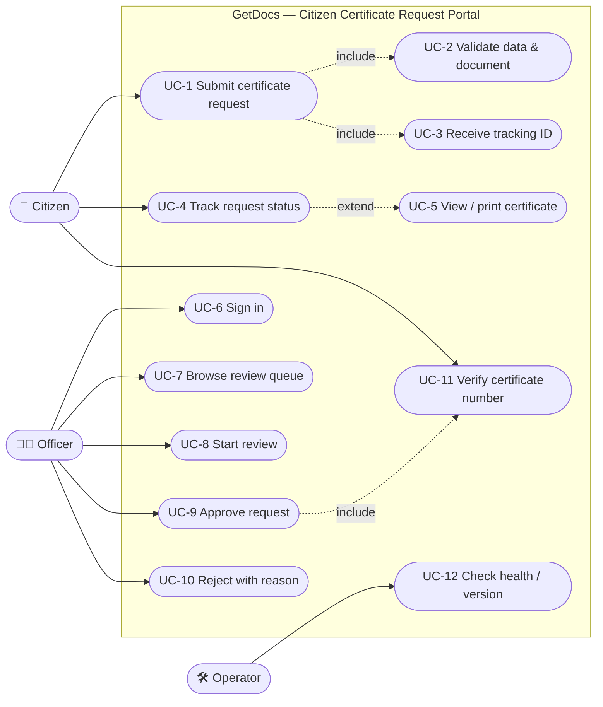
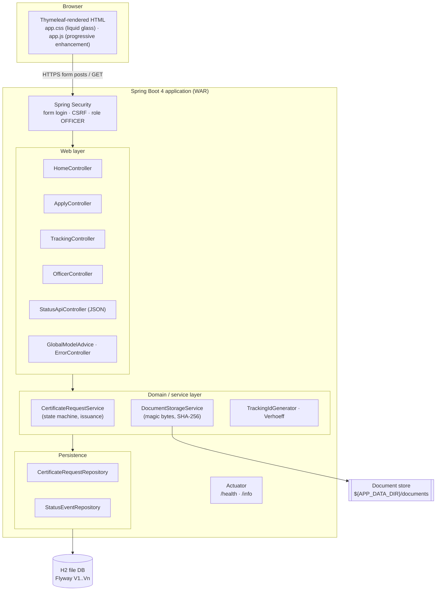
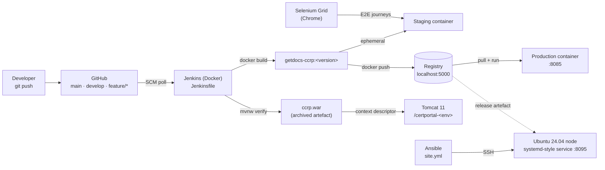
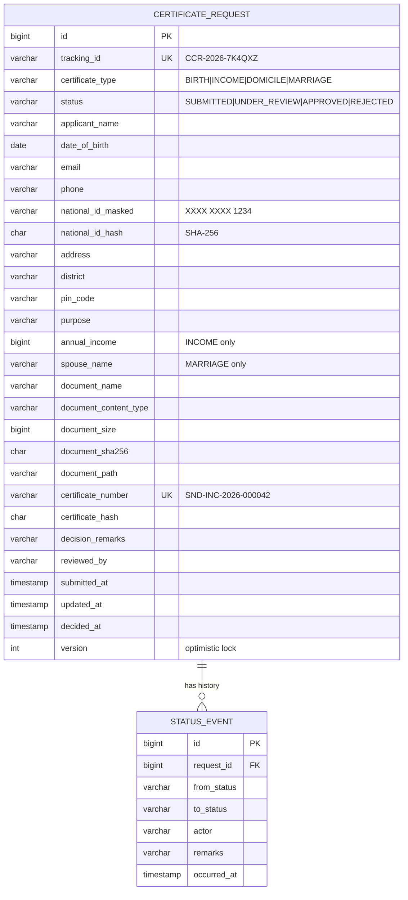
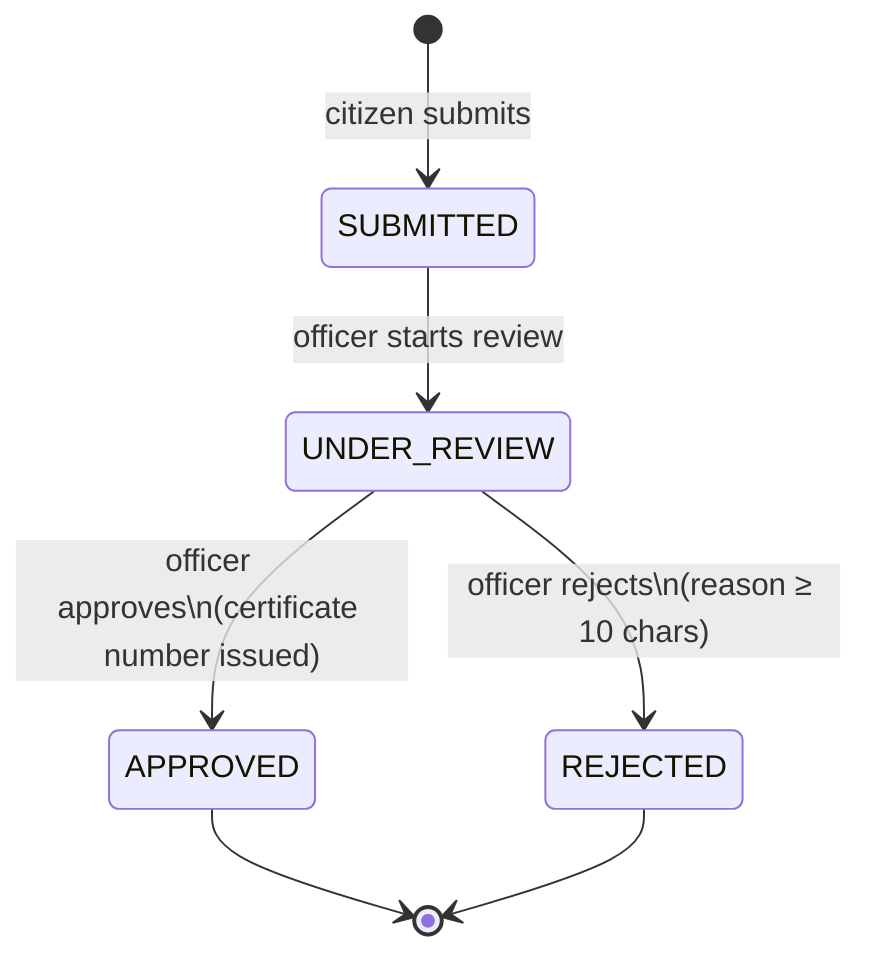

# 03 — Requirements, Architecture and Technology Setup

| Field | Value |
|---|---|
| Document ID | CCRP-DOC-03 |
| Version | 1.0 |
| Status | Approved |
| Owner | Tanishq |
| Last updated | 2026-10-11 |

## Contents

1. [SRS summary](#1-srs-summary)
2. [Use cases](#2-use-cases)
3. [Architecture](#3-architecture)
4. [Data model](#4-data-model)
5. [Status lifecycle](#5-status-lifecycle)
6. [HTTP interface (routes and API)](#6-http-interface)
7. [Technology choices](#7-technology-choices)
8. [Configuration reference](#8-configuration-reference)
9. [Local development setup](#9-local-development-setup)

---

## 1. SRS summary

### 1.1 Purpose and scope

GetDocs lets a citizen request one of four certificates (Birth, Income, Domicile, Marriage), attach one
supporting document and follow the request until an officer approves or rejects it. Scope is frozen to
the 15 MVP items in [01-problem-definition.md](01-problem-definition.md#11-mvp-scope-freeze).

### 1.2 Actors

| Actor | Description | Authentication |
|---|---|---|
| Citizen | Member of the public applying for a certificate | None. Proves ownership of a request with *tracking ID + email*. |
| Officer | Government reviewer who decides requests | Username + password (form login, session cookie) |
| Operator | DevOps engineer running the platform | Infrastructure access (Jenkins, Docker, Ansible), `/actuator/health` |
| System | Validation and certificate issuance logic | — |

### 1.3 Functional requirements

| ID | Requirement | MVP item |
|---|---|---|
| FR-01 | The citizen can choose a certificate type and submit a request with personal details, purpose and one document. | CCR-3 |
| FR-02 | All fields are validated on the server. Invalid input is returned to the form with field-level messages and the input preserved. | CCR-4 |
| FR-03 | The national ID (12 digits) is validated with the Verhoeff checksum. Only a masked form (`XXXX XXXX 1234`) and a SHA-256 fingerprint are stored. | CCR-4 |
| FR-04 | Type-specific rules: *Income* requires annual income; *Marriage* requires the spouse's name. | CCR-4 |
| FR-05 | The document must be PDF, PNG or JPEG, at most 2 MB, and its content must match its type (magic bytes). Its SHA-256 is stored. | CCR-5 |
| FR-06 | On success the system generates a unique, non-sequential tracking ID `CCR-<year>-<6 chars>` and shows an acknowledgement page. | CCR-6 |
| FR-07 | The citizen can look up a request with tracking ID + email and see the current status, a progress stepper and the full history. | CCR-7 |
| FR-08 | Officers sign in. Every `/officer/**` page requires the `OFFICER` role. | CCR-8 |
| FR-09 | Officers see KPI counts per status and a queue filterable by status and searchable by tracking ID or name. | CCR-9 |
| FR-10 | Officers can *start review* (SUBMITTED → UNDER_REVIEW), *approve* or *reject* (UNDER_REVIEW → APPROVED/REJECTED). Rejection requires a reason of at least 10 characters. Illegal transitions are refused. | CCR-10 |
| FR-11 | Approval issues a certificate number `SND-<code>-<year>-<6 digits>` and a SHA-256 verification hash. The citizen can open a printable certificate after a successful lookup. Anyone can verify a certificate number through the API. | CCR-11 |
| FR-12 | Every status change records actor, from/to status, remarks and time. | CCR-12 |
| FR-13 | Liveness/readiness health, build/git info and a JSON status endpoint are exposed. | CCR-13 |

### 1.4 Non-functional requirements

| ID | Category | Requirement |
|---|---|---|
| NFR-01 | Performance | Page render < 300 ms (p95) on the reference container (1 vCPU, 512 MB heap) for ≤ 10k requests. |
| NFR-02 | Security | CSRF protection on every form; BCrypt password hashing; session cookie `HttpOnly` + `SameSite=Lax`; officer pages unreachable anonymously; uploaded files never served from a public path. |
| NFR-03 | Privacy | Data minimisation: the full national ID is never persisted; tracking lookups require the email on file; documents are visible only to officers. |
| NFR-04 | Reliability | Graceful shutdown (20 s); Flyway-versioned schema; health probes used by Docker, Jenkins and Ansible. |
| NFR-05 | Portability | One artefact (`.war`) runs with `java -jar`, on Tomcat 11, or in a container. All settings come from environment variables. |
| NFR-06 | Testability | Unit + MockMvc integration tests on every build; Selenium journeys as a release gate. |
| NFR-07 | Usability / a11y | Responsive down to 360 px; keyboard reachable; visible focus; respects `prefers-reduced-motion` and `prefers-color-scheme`. |
| NFR-08 | Observability | Version, commit and environment are visible in the footer and at `/actuator/info`. |

---

## 2. Use cases



| Use case | Primary flow | Alternate / error flows |
|---|---|---|
| UC-1/2/3 Submit | Choose type → fill details → attach document → submit → acknowledgement with tracking ID | Field errors re-render the form with messages and keep the input; a bad document shows a document error; a file over the transport limit gives a friendly 2 MB message |
| UC-4 Track | Enter tracking ID + email → status, stepper, timeline | Unknown ID or email mismatch → the same generic "not found" message (no enumeration) |
| UC-5 Certificate | From an *Approved* tracking result → open the certificate → print | Not approved, or not looked up in this session → 404 |
| UC-8/9/10 Decide | Open the request → Start review → Approve / Reject (reason) | Illegal transition → error banner; missing reason → field error |

---

## 3. Architecture

### 3.1 Logical view (layers)



### 3.2 Deployment view



| Environment | Runtime | URL | Provisioned by |
|---|---|---|---|
| local | `./mvnw spring-boot:run` or `java -jar` | http://localhost:8080 | Developer |
| e2e | `spring-boot:start` during `-Pe2e` | http://localhost:18080 | Maven |
| staging (ephemeral) | Docker container on the CI network | http://ccrp-staging-&lt;build&gt;:8080 | Jenkins |
| tomcat-&lt;env&gt; | Tomcat 11 container | http://localhost:8888/certportal-&lt;env&gt; | Jenkins (`TARGET_ENV`) |
| production | Docker container | http://localhost:8085 | Jenkins |
| ansible-node | Ubuntu 24.04 + JRE 21 | http://localhost:8095 | Ansible |

### 3.3 Package structure

```
com.sanad.portal
├── PortalApplication            # entry point + SpringBootServletInitializer (Tomcat)
├── config/                      # AppProperties, SecurityConfig
├── domain/                      # entities, enums, repositories
├── service/                     # CertificateRequestService, DocumentStorageService, validation helpers
└── web/                         # MVC controllers, form objects, JSON API, advice, error handling
```

---

## 4. Data model



The schema is owned by Flyway (`src/main/resources/db/migration`). Hibernate runs with
`ddl-auto=validate`, so a mismatch between entities and migrations fails at start-up rather than in production.

---

## 5. Status lifecycle



Any other transition raises `IllegalStatusTransitionException` and is shown as an error, never applied.

---

## 6. HTTP interface

### 6.1 Web routes (HTML)

| Method | Path | Access | Purpose |
|---|---|---|---|
| GET | `/` | public | Landing page |
| GET | `/apply?type=` | public | Application form (optionally preselected type) |
| POST | `/apply` | public + CSRF | Submit request (multipart) |
| GET | `/apply/submitted/{trackingId}` | public (flash-guarded) | Acknowledgement |
| GET | `/track` | public | Lookup form |
| POST | `/track` | public + CSRF | Lookup by tracking ID + email (POST keeps the email out of URLs and logs) |
| GET | `/certificate/{trackingId}` | session-verified citizen, or officer | Printable certificate |
| GET | `/officer/login` | public | Officer sign-in |
| POST | `/officer/login` / `/officer/logout` | CSRF | Spring Security endpoints |
| GET | `/officer?status=&q=` | OFFICER | KPIs + queue |
| GET | `/officer/requests/{trackingId}` | OFFICER | Request detail |
| GET | `/officer/requests/{trackingId}/document` | OFFICER | Stream the supporting document (`Content-Disposition: inline`) |
| POST | `/officer/requests/{trackingId}/start-review` | OFFICER + CSRF | SUBMITTED → UNDER_REVIEW |
| POST | `/officer/requests/{trackingId}/approve` | OFFICER + CSRF | UNDER_REVIEW → APPROVED |
| POST | `/officer/requests/{trackingId}/reject` | OFFICER + CSRF | UNDER_REVIEW → REJECTED |

### 6.2 JSON API (`/api/v1`)

| Method | Path | Request | Response |
|---|---|---|---|
| GET | `/api/v1/certificate-types` | — | `[{"code":"INCOME","label":"Income certificate","slaDays":5,"requiredDocument":"…"}]` |
| POST | `/api/v1/status` | `{"trackingId":"CCR-2026-7K4QXZ","email":"a@b.in"}` | `200 {"trackingId","status","certificateType","submittedAt","updatedAt","history":[…]}` · `404` |
| GET | `/api/v1/certificates/{number}/verify` | — | `200 {"valid":true,"certificateNumber","certificateType","holderInitials","issuedAt","verificationHash"}` · `404 {"valid":false}` |

The API is stateless and exempt from CSRF; it is read-only and needs no authentication.

### 6.3 Operations

| Path | Purpose |
|---|---|
| `/actuator/health` | Aggregate health (`UP`/`DOWN`). Used by the Docker `HEALTHCHECK`, the Jenkins smoke test and the Ansible health check. |
| `/actuator/health/liveness`, `/actuator/health/readiness` | Probe groups |
| `/actuator/info` | Build version, git commit, environment, Java runtime |

---

## 7. Technology choices

| Concern | Choice | Why |
|---|---|---|
| Language / runtime | Java 21 (LTS) | Long-term support, records, pattern matching; the lab standard |
| Framework | Spring Boot 4.1 (Spring MVC, Security, Data JPA, Validation, Actuator) | Industry default; secure defaults; first-class Tomcat WAR support |
| Views | Thymeleaf, hand-written CSS/JS, no front-end build | One Maven build produces everything; pages work without JS and are easy to drive from Selenium |
| Build tool | **Maven** via wrapper (`./mvnw`, Maven 3.9.16) | Reproducible builds with no local Maven install; native Jenkins/Surefire/Failsafe reporting |
| Database | H2 2.x in file mode (PostgreSQL compatibility), Flyway | No external DB server for the MVP; Flyway migrations keep a later move to PostgreSQL to a config change |
| Packaging | Executable **WAR** | Same artefact for `java -jar`, Docker and **Tomcat 11** |
| Deployment targets | Tomcat 11 (Jakarta Servlet 6.1) and Docker (`eclipse-temurin:21-jre`) | Both deployment styles the course requires |
| Tests | JUnit 5, Spring MockMvc, Selenium WebDriver 4 (Chrome) | Unit → integration → E2E pyramid |
| CI/CD | Jenkins LTS (JDK 21) in Docker, Configuration-as-Code, Jenkinsfile | Pipeline-as-code, reproducible controller |
| Config management | Ansible | Agentless (SSH); YAML playbooks are easy to review |

---

## 8. Configuration reference

| Property | Env var | Default | Notes |
|---|---|---|---|
| `server.port` | `SERVER_PORT` | `8080` | |
| `app.environment` | `APP_ENVIRONMENT` | `local` | Shown as a badge in the footer: local / e2e / staging / production |
| `app.data-dir` | `APP_DATA_DIR` | `./data` | H2 files in `db/`, uploads in `documents/` |
| `app.documents.max-size` | `APP_DOCUMENTS_MAX_SIZE` | `2MB` | Business limit for uploads |
| `app.officer.username` | `APP_OFFICER_USERNAME` | `officer` | |
| `app.officer.password` | `APP_OFFICER_PASSWORD` | `Officer@123` (local only) | Injected from Jenkins credentials or Ansible Vault outside local |
| `spring.profiles.active` | `SPRING_PROFILES_ACTIVE` | — | `dev` disables template caching |

---

## 9. Local development setup

### 9.1 Prerequisites

| Tool | Version | Check |
|---|---|---|
| JDK | 21 | `java -version` |
| Git | ≥ 2.40 | `git --version` |
| Google Chrome | any current | `google-chrome --version` (needed only for Selenium) |
| Docker Engine + Compose | ≥ 24 / v2 | `docker compose version` (needed only for CI/CD and containers) |

Maven does **not** need to be installed. `./mvnw` downloads the pinned version on first use.

### 9.2 Run

```bash
git clone git@github.com:tanishqbuilds/citizen-certificate-portal.git
cd citizen-certificate-portal

./mvnw spring-boot:run -Dspring-boot.run.profiles=dev     # http://localhost:8080
# or
./mvnw -DskipTests package && java -jar target/*.war
```

Officer sign-in for local runs: `officer` / `Officer@123`.

### 9.3 Test

```bash
./mvnw verify            # unit + MockMvc integration tests, JaCoCo report in target/site/jacoco
./mvnw verify -Pe2e      # also starts the app on :18080 and runs the Selenium journeys (headless Chrome)
```

### 9.4 Verified local setup (evidence)

```text
$ ./mvnw -B verify
[INFO] Tests run: 2, Failures: 0, Errors: 0, Skipped: 0
[INFO] BUILD SUCCESS

$ java -jar target/citizen-certificate-portal-0.1.0-SNAPSHOT.war &
$ curl -s localhost:8080/actuator/health
{"groups":["liveness","readiness"],"status":"UP"}
$ curl -s localhost:8080/actuator/info
{"app":{"name":"GetDocs — Citizen Certificate Request Portal","environment":"local"},
 "git":{"branch":"main","commit":{"id":"2c7d1b2",…}},
 "build":{"artifact":"citizen-certificate-portal","version":"0.1.0-SNAPSHOT",…}}
```
