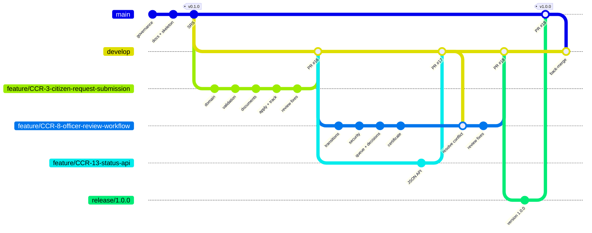

# 04 — Git, GitHub and Collaboration (Phases 4–6)

| Field | Value |
|---|---|
| Document ID | CCRP-DOC-04 |
| Version | 1.0 |
| Status | Approved |
| Owner | Tanishq |
| Last updated | 2026-10-11 |

## Contents

1. [Repository](#1-repository)
2. [Branch model and naming rules](#2-branch-model-and-naming-rules)
3. [Commit convention](#3-commit-convention)
4. [Issues, labels and milestones](#4-issues-labels-and-milestones)
5. [Phase 5: feature branch, pull request and review](#5-phase-5--feature-branch-pull-request-and-review)
6. [Phase 6: second feature branch and merge conflict](#6-phase-6--second-feature-branch-and-merge-conflict)
7. [Release v1.0.0 and tagging](#7-release-v100-and-tagging)
8. [Backlog status at v1.0.0](#8-backlog-status-at-v100)
9. [Everyday Git command reference](#9-everyday-git-command-reference)

---

## 1. Repository

| Item | Value |
|---|---|
| URL | https://github.com/tanishqbuilds/citizen-certificate-portal |
| Visibility | Public |
| Default branch | `main` |
| Merge strategy | **Merge commits only** (squash and rebase disabled) so feature boundaries remain visible in `git log --graph` |
| Templates | `.github/ISSUE_TEMPLATE/{user_story,bug_report,devops_task}.yml`, `.github/pull_request_template.md` |
| Ownership | `.github/CODEOWNERS` → `@tanishqbuilds` |
| Policy | [`CONTRIBUTING.md`](../CONTRIBUTING.md) |

Initial commits on `main`:

```text
2c7d1b2 chore: initialize repository with governance files
c6b4010 docs: add problem definition, stakeholders and frozen MVP scope
4bcb806 build: add Spring Boot 4 skeleton with Maven wrapper and design system
f48b0cc docs: add SRS summary, architecture, data model and API list   (tag v0.1.0)
```

## 2. Branch model and naming rules



| Prefix | Use | Example in this repo |
|---|---|---|
| `feature/CCR-<n>-<slug>` | User-facing story | `feature/CCR-3-citizen-request-submission` |
| `fix/CCR-<n>-<slug>` | Non-urgent defect | `fix/CCR-14-...` (Phase 10) |
| `ci/<slug>` | Jenkins / Docker / Ansible | `ci/jenkins-pipeline` (Phase 7–8) |
| `docs/<slug>` | Documentation only | — |
| `release/<x.y.z>` | Release hardening | `release/1.0.0` |
| `hotfix/<x.y.z>` | Urgent production fix | — |

Rules: lowercase, hyphen-separated, the backlog key is mandatory for `feature/` and `fix/`, and nobody commits directly to `main` or `develop`. Everything arrives through a pull request.

## 3. Commit convention

[Conventional Commits](https://www.conventionalcommits.org/) with a `Refs: CCR-<n>` trailer. Each commit is one logical change that builds on its own. Examples from the history:

```text
feat(validation): validate applicant data and type-specific rules
feat(documents): validate uploads by magic bytes and store with SHA-256
fix(security): resolve CSRF tokens eagerly to avoid committed-response errors
fix(validation): evaluate ages in IST instead of the JVM default zone
refactor(officer): detect anonymous users by type and flag truncated queues
```

## 4. Issues, labels and milestones

| Artefact | Content |
|---|---|
| Issues #1–#15 | One per MVP backlog item (issue *n* = CCR-*n*), body = story + acceptance criteria from [`backlog.csv`](agile/backlog.csv) |
| Labels | `type:story`, `type:task`, `type:bug`, `epic:citizen`, `epic:officer`, `epic:platform`, `priority:must`, `priority:should`, `status:*` |
| Milestones | Sprint 0 → Sprint 4 with due dates from the sprint plan |

## 5. Phase 5: feature branch, pull request and review

**Feature 1:** citizen journey (CCR-3 … CCR-7) on `feature/CCR-3-citizen-request-submission`.

```bash
git checkout -b feature/CCR-3-citizen-request-submission develop
# … work …
git add <files>; git commit -m "feat(domain): …"     # 6 focused commits
git push -u origin feature/CCR-3-citizen-request-submission
gh pr create --base develop --title "feat: citizen request submission …" --body-file pr.md
git pull --ff-only origin develop                     # after merge
git log --oneline --graph
```

| Step | Evidence |
|---|---|
| Pull request | [#16](https://github.com/tanishqbuilds/citizen-certificate-portal/pull/16) with the PR template completed |
| Review comments | 3 inline comments: orphaned documents on failed save, UTC vs IST age calculation, rate limiting (deferred) |
| Changes after review | `41e1335`, `cecef29`, `18fcf05`, `2b87f5c` (screenshots), each replied to on the thread |
| Merge | Merge commit `cb3f3f2` into `develop` |
| Screenshots | [`docs/evidence/phase-05-feature-branch/`](evidence/phase-05-feature-branch/) |

## 6. Phase 6: second feature branch and merge conflict

Two branches were developed **in parallel** from the same `develop` commit (`cb3f3f2`):

| Branch | PR | Touches |
|---|---|---|
| `feature/CCR-13-status-api` | [#17](https://github.com/tanishqbuilds/citizen-certificate-portal/pull/17), merged first | `SecurityConfig` (CSRF exemption for `/api/**`), repository, service, README |
| `feature/CCR-8-officer-review-workflow` | [#18](https://github.com/tanishqbuilds/citizen-certificate-portal/pull/18) | `SecurityConfig` (form login, roles), repository, service, README |

After #17 merged, GitHub reported #18 as **`CONFLICTING`**. Resolution, done on the feature branch so `develop` was never broken:

```text
$ git merge origin/develop
CONFLICT (content): Merge conflict in README.md
CONFLICT (content): Merge conflict in src/main/java/com/sanad/portal/config/SecurityConfig.java
CONFLICT (content): Merge conflict in src/main/java/com/sanad/portal/domain/CertificateRequestRepository.java
CONFLICT (content): Merge conflict in src/main/java/com/sanad/portal/service/CertificateRequestService.java
Automatic merge failed; fix conflicts and then commit the result.
```

| File | Decision |
|---|---|
| `SecurityConfig.java` | Semantic merge: officer login + role rules from the feature **and** `ignoringRequestMatchers("/api/**")` from develop |
| Repository / service | Additive. Both sides' methods kept. The first attempt dropped a closing brace; `./mvnw clean verify` caught it before the merge commit |
| `README.md` | Both feature lists combined |

Merge commit `bb45e4a`, then a cross-feature test (`ff81763`) that approves a request and verifies its certificate through the new API, which neither branch could test alone. Full log: [`merge-conflict.log`](evidence/phase-06-mvp/merge-conflict.log). Screenshots of the complete MVP: [`docs/evidence/phase-06-mvp/`](evidence/phase-06-mvp/).

## 7. Release v1.0.0 and tagging

```bash
git checkout -b release/1.0.0 develop
./mvnw versions:set -DnewVersion=1.0.0 -DgenerateBackupPoms=false
# CHANGELOG.md, docs → PR release/1.0.0 → main
git tag -a v1.0.0 -m "GetDocs v1.0.0 — MVP"
git push origin v1.0.0
git checkout develop && git merge --no-ff main          # back-merge
./mvnw versions:set -DnewVersion=1.1.0-SNAPSHOT         # next development iteration
```

The tagged commit on `main` is the **release-ready source baseline**. `./mvnw clean verify` passes on it (65 tests), it builds `citizen-certificate-portal-1.0.0.war`, and `/actuator/info` reports version `1.0.0` with the tag's commit.

## 8. Backlog status at v1.0.0

| Key | Story | Issue | Delivered by | Status |
|---|---|---|---|---|
| CCR-1 | Repository & project skeleton | #1 | v0.1.0 | ✅ Done |
| CCR-2 | Design system & UI shell | #2 | v0.1.0 | ✅ Done |
| CCR-3 | Certificate request submission | #3 | PR #16 | ✅ Done |
| CCR-4 | Applicant data validation | #4 | PR #16 | ✅ Done |
| CCR-5 | Document upload & validation | #5 | PR #16 | ✅ Done |
| CCR-6 | Tracking ID & acknowledgement | #6 | PR #16 | ✅ Done |
| CCR-7 | Status tracking with timeline | #7 | PR #16 | ✅ Done |
| CCR-8 | Officer authentication | #8 | PR #18 | ✅ Done |
| CCR-9 | Review queue with filters & KPIs | #9 | PR #18 | ✅ Done |
| CCR-10 | Review actions (state machine) | #10 | PR #18 | ✅ Done |
| CCR-11 | Certificate issuance & verification | #11 | PR #18 | ✅ Done |
| CCR-12 | Audit trail | #12 | PR #16, #18 | ✅ Done |
| CCR-13 | Health, info & JSON API | #13 | PR #17 | ✅ Done |
| CCR-14 | Selenium E2E suite | #14 | — | ⏳ Sprint 3 |
| CCR-15 | Containerised CI/CD & provisioning | #15 | — | ⏳ Sprint 4 |

13 of 15 items done. 55 of 76 story points burned.

## 9. Everyday Git command reference

| Goal | Command |
|---|---|
| Start a story | `git switch develop && git pull && git switch -c feature/CCR-<n>-<slug>` |
| Stage interactively by file | `git add <path>`; review with `git diff --staged` |
| Commit | `git commit` (Conventional Commit subject + `Refs:` trailer) |
| Publish | `git push -u origin <branch>` |
| Stay current | `git fetch && git merge origin/develop` (never rebase shared branches) |
| History | `git log --oneline --graph --decorate --all` |
| Who changed a line | `git blame -L <from>,<to> <file>` |
| Undo a pushed commit | `git revert <sha>` (never force-push shared branches) |
| Inspect a release | `git show v1.0.0`, `git diff v0.1.0..v1.0.0 --stat` |
