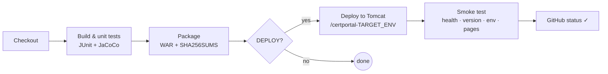

# 05 — Jenkins CI, Pipeline as Code and Tomcat Deployment (Phases 7–8)

| Field | Value |
|---|---|
| Document ID | CCRP-DOC-05 |
| Version | 1.0 |
| Status | Approved |
| Owner | Tanishq |
| Last updated | 2026-10-11 |

## Contents

1. [Toolchain topology](#1-toolchain-topology)
2. [Installing Jenkins (as code)](#2-installing-jenkins-as-code)
3. [Phase 7: the CI job](#3-phase-7--the-ci-job)
4. [Phase 8: Jenkinsfile](#4-phase-8--jenkinsfile)
5. [Tomcat deployment and the `TARGET_ENV` parameter](#5-tomcat-deployment-and-the-target_env-parameter)
6. [Evidence](#6-evidence)
7. [Problems found and fixed](#7-problems-found-and-fixed)
8. [Operating the toolchain](#8-operating-the-toolchain)

---

## 1. Toolchain topology

```mermaid
flowchart LR
    dev["Developer"] -->|git push / PR merge| gh["GitHub<br/>tanishqbuilds/citizen-certificate-portal"]
    subgraph host["Docker host · network ccrp-ci"]
        jenkins["ccrp-jenkins<br/>Jenkins 2.580.1 LTS · JDK 21<br/>:8090"]
        tomcat["ccrp-tomcat<br/>Tomcat 11.0.26 · JRE 21<br/>:8888"]
        sock[("/var/run/docker.sock")]
    end
    jenkins -->|"poll every 2 min (git ls-remote)"| gh
    jenkins -->|commit status| gh
    jenkins -->|docker cp + Manager text API| tomcat
    jenkins --- sock
```



All CI/CD components run in Docker and are described in code:

| Path | Content |
|---|---|
| `ci/docker-compose.yml` | Services, ports, volumes, network `ccrp-ci` |
| `ci/jenkins/Dockerfile` | Jenkins LTS + Docker CLI/buildx + pinned plugins, setup wizard disabled |
| `ci/jenkins/plugins.txt` | 15 pinned top-level plugins (JCasC, Job DSL, Pipeline, Git, JUnit, Coverage, …) |
| `ci/jenkins/casc/jenkins.yaml` | Security realm, authorisation, credentials, global env vars |
| `ci/jenkins/casc/jobs.groovy` | Job DSL for `ccrp-ci-build` and `ccrp-pipeline` |
| `infra/tomcat/` | Tomcat image, Manager restrictions, `manager-script` user template |
| `scripts/ci-up.sh` | Generates `ci/.env` with random secrets, builds, starts, prints URLs |

## 2. Installing Jenkins (as code)

```bash
scripts/ci-up.sh                     # first run creates ci/.env (chmod 600) with random secrets
# optional: let Jenkins publish commit statuses
GITHUB_TOKEN=$(gh auth token) scripts/ci-up.sh
```

| Concern | How it is handled |
|---|---|
| Admin user | JCasC `securityRealm.local` from `JENKINS_ADMIN_PASSWORD`. Sign-up disabled, anonymous read off |
| Secrets | Jenkins credentials `tomcat-deployer`, `officer-password` and `github-token`, created by JCasC from env vars. Never in Git |
| Plugins | Installed at image build time by `jenkins-plugin-cli`, versions pinned |
| Jobs | Created by Job DSL at start-up. Nothing is configured by clicking |
| Docker access | Host socket mounted; container joins the socket's group (`DOCKER_GID`) |
| Reproducibility | `docker compose down -v && scripts/ci-up.sh` rebuilds an identical controller |

## 3. Phase 7: the CI job

`ccrp-ci-build`, a freestyle job (Job DSL):

| Setting | Value |
|---|---|
| SCM | `https://github.com/tanishqbuilds/citizen-certificate-portal.git`, branch `*/develop`, clean before checkout |
| Trigger | **SCM polling `H/2 * * * *`**. A GitHub webhook cannot reach a laptop without a public tunnel, so polling is the reliable trigger |
| Build | `./mvnw -B -ntp clean verify` (Maven wrapper 3.9.16: compile, 65 tests, JaCoCo, package) |
| Post-build | JUnit report; `target/*.war` archived with a fingerprint, only on success |
| Hygiene | 20-minute timeout, timestamps, keep 30 builds / 10 artefacts |

**Trigger evidence:** the polling log shows the change detection, and build #2 records `Started by an SCM change`:

```text
[poll] Last Built Revision: Revision 27977e4c… (refs/remotes/origin/develop)
 > git ls-remote -h -- https://github.com/tanishqbuilds/citizen-certificate-portal.git
[poll] Latest remote head revision on refs/heads/develop is: debded13…
Changes found
```

## 4. Phase 8: Jenkinsfile



| Stage | Key steps |
|---|---|
| Checkout | `checkout scm`; derives `GIT_COMMIT`, `APP_VERSION` (from the POM); names the build `#n · version · sha`; GitHub status `pending` |
| Build & unit tests | `./mvnw clean verify`; `junit`; `recordCoverage` (JaCoCo) |
| Package | Archive `citizen-certificate-portal-<version>.war` + `SHA256SUMS`, fingerprinted |
| Deploy to Tomcat | `scripts/deploy-tomcat.sh target/ccrp.war "$TARGET_ENV"` with credentials bound from Jenkins |
| Smoke test | `scripts/smoke-test.sh` asserts health `UP`, `build.version == APP_VERSION`, `app.environment == TARGET_ENV`, pages render, `/officer` redirects |
| post | GitHub commit status `success` / `failure` (context `jenkins/ccrp-pipeline`); workspace cleaned |

Options: `timestamps`, `ansiColor`, 30-minute timeout, `disableConcurrentBuilds`, build discarder.

## 5. Tomcat deployment and the `TARGET_ENV` parameter

| Parameter | Values | Effect |
|---|---|---|
| **`TARGET_ENV`** | `staging` (default), `production` | Context path `/certportal-<env>`, `app.environment`, data directory `/usr/local/tomcat/data/<env>` |
| `DEPLOY` | `true` (default), `false` | Skip deployment (build-only run) |

The same WAR serves both environments. `scripts/deploy-tomcat.sh` generates a **context descriptor** whose `<Parameter>` elements become ServletContext init parameters, which Spring Boot reads as configuration:

```xml
<Context>
  <Parameter name="app.environment" value="production" override="false"/>
  <Parameter name="app.data-dir"    value="/usr/local/tomcat/data/production" override="false"/>
  <Parameter name="app.officer.password" value="********" override="false"/>
</Context>
```

and deploys through the Manager text API:

```text
GET /manager/text/undeploy?path=/certportal-production                       (if already running)
GET /manager/text/deploy?path=/certportal-production
        &config=file:/usr/local/tomcat/deployments/certportal-production.xml
        &war=file:/usr/local/tomcat/deployments/certportal-production.war
        &tag=1.1.0-SNAPSHOT
OK - Deployed application at context path [/certportal-production]
```

The Manager is restricted to loopback and private networks (`RemoteCIDRValve`), and the deploy account has only `manager-script` (text API, no GUI).

| URL | Environment |
|---|---|
| http://localhost:8888/certportal-staging/ | staging (polled builds) |
| http://localhost:8888/certportal-production/ | production (parameterised build #3) |

## 6. Evidence

| Phase | Item | File |
|---|---|---|
| 7 | Jenkins dashboard, job page with artefact and test trend | [`phase-07-jenkins-ci/01–02`](evidence/phase-07-jenkins-ci/) |
| 7 | Successful build log (`Started by an SCM change`, 65 tests, archived WAR) | [`build-2-success-console.log`](evidence/phase-07-jenkins-ci/build-2-success-console.log) |
| 7 | Polling log | [`scm-polling.log`](evidence/phase-07-jenkins-ci/scm-polling.log) |
| 7 | Archived artefact + fingerprint | [`build-2-artifacts.json`](evidence/phase-07-jenkins-ci/build-2-artifacts.json) |
| 8 | Stage view and stage graph | [`phase-08-pipeline-tomcat/01, 02b`](evidence/phase-08-pipeline-tomcat/) |
| 8 | Parameters (`TARGET_ENV=production`) | [`03-build-with-parameters.png`, `04-build-3-parameters.png`](evidence/phase-08-pipeline-tomcat/) |
| 8 | Pipeline logs (#1 failure, #2 staging, #3 production) | [`pipeline-build-*.log`](evidence/phase-08-pipeline-tomcat/) |
| 8 | Manager list, context descriptor, `/actuator/info` per env, GitHub statuses | [`tomcat-deployment-evidence.txt`](evidence/phase-08-pipeline-tomcat/tomcat-deployment-evidence.txt) |
| 8 | Deployed application on Tomcat | [`08-tomcat-staging-home.png`, `09-tomcat-production-apply.png`](evidence/phase-08-pipeline-tomcat/) |

## 7. Problems found and fixed

| # | Symptom | Root cause | Fix |
|---|---|---|---|
| 1 | Jenkins kept restarting | `excludeClientIPFromCrumb` no longer exists in the crumb issuer | `crumbIssuer: "standard"` |
| 2 | Polled build queued but never ran | Built-in node went **offline**: host root disk at 100% (Disk Space Monitor < 1 GB) | Freed space (Docker build cache), node back online |
| 3 | `ccrp-ci-build` #1: login test failed | Jenkins exports `APP_OFFICER_PASSWORD`; env vars outrank `application-test.yml` | Test pins the password via `@SpringBootTest(properties=…)` (#22) |
| 4 | Context failed on Tomcat: `NoClassDefFoundError: …/WebServer` | Maven nearest-wins put `spring-boot-web-server` in `lib-provided` | Declare it explicitly at compile scope (#23) |
| 5 | `ccrp-pipeline` #1: deploy called with empty env | Jenkinsfile parameters only exist after the first run | Parameters also in Job DSL; defaults in the Jenkinsfile (#24) |
| 6 | Smoke checks silently skipped | `curl … \| grep -q` closes the pipe early (curl exit 23) and `&&` swallowed it | Fetch into a variable, then assert |

## 8. Operating the toolchain

| Task | Command |
|---|---|
| Start / update | `scripts/ci-up.sh` |
| Stop (keep data) | `docker compose -f ci/docker-compose.yml --env-file ci/.env stop` |
| Reset completely | `docker compose -f ci/docker-compose.yml --env-file ci/.env down -v` |
| Trigger a production deploy | Jenkins → *CCRP · Delivery pipeline* → *Build with Parameters* → `TARGET_ENV=production` |
| Same from the CLI | `curl -u admin:$PW -X POST "http://localhost:8090/job/ccrp-pipeline/buildWithParameters?TARGET_ENV=production"` (crumb required) |
| Deploy by hand | `TOMCAT_URL=http://localhost:8888 TOMCAT_USER=deployer TOMCAT_PASSWORD=… OFFICER_PASSWORD=… scripts/deploy-tomcat.sh target/*.war staging` |
| Tomcat logs | `docker logs -f ccrp-tomcat` |
