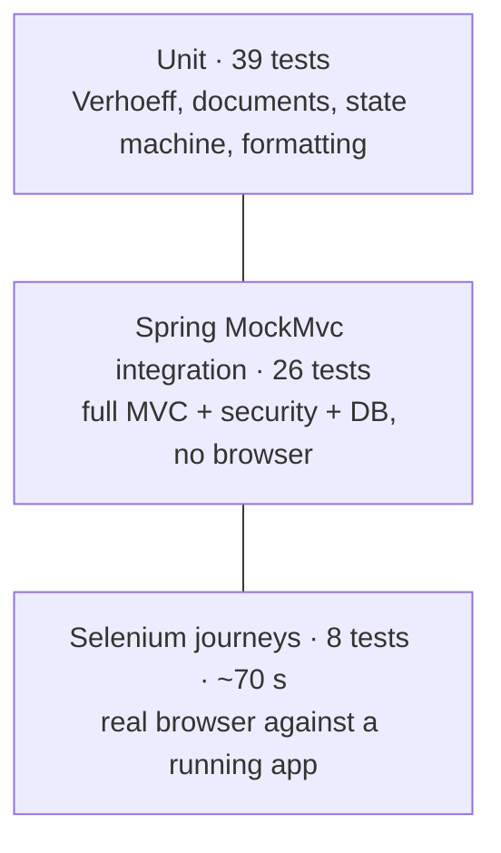
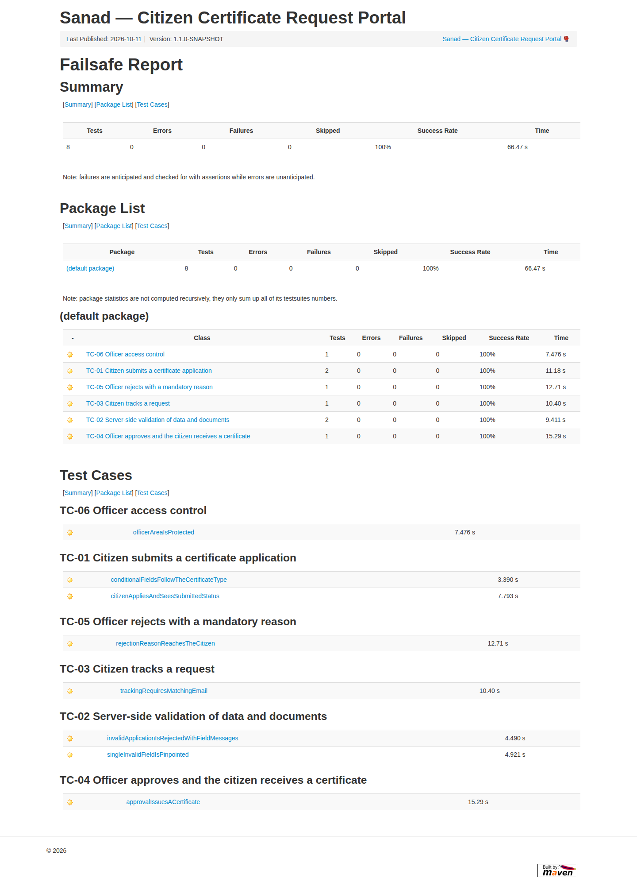

# 06 — Selenium Test Plan and Local Execution (Phase 9)

| Field | Value |
|---|---|
| Document ID | CCRP-DOC-06 |
| Version | 1.0 |
| Status | Approved |
| Owner | Tanishq |
| Last updated | 2026-10-11 |

## Contents

1. [Scope and objectives](#1-scope-and-objectives)
2. [Test strategy (pyramid)](#2-test-strategy)
3. [Critical user journeys](#3-critical-user-journeys)
4. [Test cases](#4-test-cases)
5. [Test data](#5-test-data)
6. [Framework design](#6-framework-design)
7. [Running the suite](#7-running-the-suite)
8. [Failure screenshots](#8-failure-screenshots)
9. [Results](#9-results)
10. [Defects found while building the suite](#10-defects-found-while-building-the-suite)
11. [Entry / exit criteria](#11-entry--exit-criteria)

---

## 1. Scope and objectives

The suite verifies the deployed portal **through a real browser**, as a citizen and an officer use it. It is the release quality gate (Phase 10): a failing journey stops deployment.

| In scope | Out of scope |
|---|---|
| Citizen application, validation, tracking, certificate | Load and performance testing |
| Officer sign-in, queue, start review, approve, reject | Cross-browser matrix (Chrome only for the MVP) |
| Access control of the officer area | Visual regression / pixel diffs |
| Server-side validation as seen by the user | Accessibility audit (manual check only) |

## 2. Test strategy



| Level | Tool | Runs in | When |
|---|---|---|---|
| Unit | JUnit 5, AssertJ, Mockito | `surefire` (`./mvnw verify`) | Every build |
| Integration | Spring Boot Test, MockMvc, H2 | `surefire` | Every build |
| End to end | Selenium WebDriver 4.51, Chrome | `failsafe` (`-Pe2e`) | Every pipeline run, before deployment |

## 3. Critical user journeys

| ID | Journey | Why it is critical |
|---|---|---|
| CJ-1 | Citizen applies and receives a tracking ID | The core service. If this breaks, nobody can apply |
| CJ-2 | Invalid data and documents are stopped at the door | Protects officers and data quality; the MVP's main promise |
| CJ-3 | Citizen tracks a request with tracking ID + email | Replaces office visits and phone calls; privacy-sensitive |
| CJ-4 | Officer reviews and approves; citizen gets a certificate | The end-to-end value chain across two roles and two browsers |
| CJ-5 | Officer rejects with a reason the citizen can read | Accountability: no silent rejections |
| (security) | Officer area closed to anonymous users and wrong passwords | Protects personal data |

## 4. Test cases

| TC | Class · method | Journey | Steps (abridged) | Assertions |
|---|---|---|---|---|
| TC-01a | `CitizenApplicationJourney.citizenAppliesAndSeesSubmittedStatus` | CJ-1 | Home → Apply → fill *income* applicant → declare → submit → Track status | Tracking ID matches `CCR-\d{4}-[A-Z2-9]{6}`; type label; status *Submitted*; timeline = [Request submitted] |
| TC-01b | `…conditionalFieldsFollowTheCertificateType` | CJ-1 | Choose Income, then Marriage | Income field shown only for Income; spouse only for Marriage |
| TC-02a | `ApplicationValidationJourney.invalidApplicationIsRejectedWithFieldMessages` | CJ-2 | Submit the *invalid* applicant with a text file renamed `.pdf` | 10 fields flagged incl. national-ID checksum, PIN, document type; typed values kept |
| TC-02b | `…singleInvalidFieldIsPinpointed` | CJ-2 | Valid applicant + fake PDF | Exactly one error (`document`), banner says "One thing…" |
| TC-03 | `StatusTrackingJourney.trackingRequiresMatchingEmail` | CJ-3 | Apply in browser A; in browser B look up with wrong email, malformed ID, then correct email with different case | Generic not-found message; validation error; result with *Submitted* |
| TC-04 | `OfficerApprovalJourney.approvalIssuesACertificate` | CJ-4 | Citizen applies; officer (2nd browser) signs in, searches, opens, starts review, approves; citizen refreshes and opens certificate | KPI > 0; citizen sees *Under review* then *Approved*; `SND-INC-YYYY-NNNNNN`; audit trail of 3 entries; certificate shows number, 64-char hash, name, ₹4,50,000 |
| TC-05 | `OfficerRejectionJourney.rejectionReasonReachesTheCitizen` | CJ-5 | Officer starts review, rejects with "No", then with a full reason | Short reason refused (status unchanged); full reason → *Rejected*; citizen sees the exact reason |
| TC-06 | `AccessControlJourney.officerAreaIsProtected` | security | Open `/officer` anonymously; wrong password; correct password; sign out | Redirect to login; error message; queue shown; `?signedOut` |

## 5. Test data

| Source | Content |
|---|---|
| [`src/test/resources/e2e/applicants.csv`](../src/test/resources/e2e/applicants.csv) | 4 valid applicants (one per certificate type) and 1 deliberately invalid one. National IDs carry valid Verhoeff check digits, except the invalid row's |
| [`src/test/resources/e2e/documents/`](../src/test/resources/e2e/documents/) | `income-proof.pdf` (real PDF), `address-proof.png` (real PNG), `not-really-a-pdf.pdf` (plain text with a `.pdf` name) |
| Run isolation | Emails get a per-run suffix (`aarav.sharma+e2e-<run>@example.com`), so repeated runs against a shared staging environment never collide |

## 6. Framework design

```
src/test/java/com/sanad/portal/e2e/
├── support/
│   ├── E2EConfig                       system properties: base URL, grid URL, headless, credentials, timeouts
│   ├── DriverFactory                   local Chrome (Selenium Manager) or RemoteWebDriver (Grid) + LocalFileDetector
│   ├── BaseJourney                     fresh browser per test, @Tag("e2e"), screenshot extension
│   ├── ScreenshotOnFailureExtension    PNG + page source + URL on failure (before the browser closes)
│   └── TestData                        CSV loader, document resolver, unique emails
├── pages/                              Page Object Model (one class per screen)
│   ├── Page                            explicit waits, data-testid locators, reloadsPage()
│   ├── HomePage · ApplyPage · AcknowledgementPage · TrackPage · CertificatePage
│   └── OfficerLoginPage · OfficerQueuePage · OfficerRequestPage
└── *Journey.java                       the six journey classes (TC-01 … TC-06)
```

Design rules:

- **Stable locators:** every interactive element has a `data-testid`. Tests never depend on CSS classes or text layout.
- **Explicit waits only:** implicit wait is 0. `reloadsPage()` waits for the old `<html>` element to go stale before looking for the next state, which prevents matching the previous page.
- **Independent journeys:** each test opens its own browser and creates its own data, so any order or subset can run.
- **Two-actor journeys** (citizen + officer) use two browsers, as in real life.

## 7. Running the suite

| Mode | Command | What happens |
|---|---|---|
| **Local (self-contained)** | `./mvnw verify -Pe2e` | Unit and integration tests, package, `spring-boot:start` on :18080 with a fresh data dir, 8 journeys in headless Chrome, `spring-boot:stop`, HTML report |
| Local, visible browser | `./mvnw verify -Pe2e -De2e.headless=false` | Same, but watch Chrome drive the app |
| Against a running app | `./mvnw verify -Pe2e -De2e.external=true -De2e.baseUrl=http://localhost:8080` | No app start; useful against Tomcat or a container |
| Through a Selenium Grid (CI) | `… -De2e.remoteUrl=http://ccrp-selenium:4444` | `RemoteWebDriver`; files uploaded via `LocalFileDetector` |
| Capture every journey | `-De2e.captureAll=true` | Also screenshots passing journeys (`target/selenium-screenshots/passed/`) |
| One journey | `-Dit.test=OfficerApprovalJourney` | |

Reports: `target/failsafe-reports/*.xml` (JUnit XML for Jenkins) and **`target/reports/failsafe.html`** (HTML).

## 8. Failure screenshots

`ScreenshotOnFailureExtension` runs in JUnit's `AfterTestExecutionCallback`, before `@AfterEach` closes the browser. For every failed test it writes:

```
target/selenium-screenshots/failed/<Class>_<method>_<yyyyMMdd-HHmmss>.png    what the user saw
                                                                    .html   full page source
                                                                    .txt    URL + exception
```

A real example from development, when Chrome's password-breach bubble swallowed clicks (§10), is in [`evidence/phase-09-selenium/failure-screenshot-example/`](evidence/phase-09-selenium/failure-screenshot-example/). Jenkins archives this folder on every run (Phase 10).

## 9. Results

Local run, `./mvnw clean verify -Pe2e -De2e.captureAll=true` ([log](evidence/phase-09-selenium/local-maven-e2e-run.log)):

| Suite | Tests | Failures | Errors | Time |
|---|---|---|---|---|
| Unit + integration (surefire) | 65 | 0 | 0 | ~20 s |
| Selenium journeys (failsafe) | 8 | 0 | 0 | 66 s |



Screenshots of the final state of every journey are in [`evidence/phase-09-selenium/passed-journeys/`](evidence/phase-09-selenium/passed-journeys/).

## 10. Defects found while building the suite

| # | Found by | Defect | Fix |
|---|---|---|---|
| 1 | TC-01/TC-02 | **Product bug:** clicking the declaration *text* did nothing. The label had `for="declaration"` but Thymeleaf renders the checkbox as `id="declaration1"` | Label wraps the input without `for` |
| 2 | TC-01 | `html { scroll-behavior: smooth }` made Selenium click while the page was still scrolling (click intercepted) | Smooth scrolling removed; it added nothing to the UX |
| 3 | TC-06 | Chrome flagged `Officer@123` as breached and opened a native *Change your password* bubble that swallowed all clicks after sign-in | `DriverFactory` disables password-leak detection and the password manager |
| 4 | TC-04/05 | Stale elements: waits matched the previous page after a form post | `Page.reloadsPage()` waits for staleness of the old document |
| 5 | Debugging | Running e2e against `java -jar target/*.war` while Maven rebuilt that same file broke class loading | Run the app under test from a copy (CI uses a container) |

## 11. Entry / exit criteria

| | Criteria |
|---|---|
| Entry | Build green (unit + integration); app healthy at `e2e.baseUrl`; Chrome or a Grid reachable |
| Exit (release gate) | **All journeys pass.** Any failure stops the pipeline before deployment (Phase 10). No retries, so flaky tests are fixed rather than hidden |
