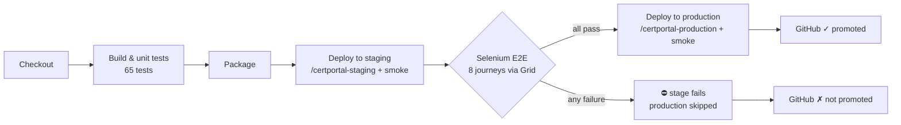

# 07 — Continuous Testing in Jenkins: the Selenium Quality Gate (Phase 10)

| Field | Value |
|---|---|
| Document ID | CCRP-DOC-07 |
| Version | 1.0 |
| Status | Approved |
| Owner | Tanishq |
| Last updated | 2026-10-11 |

## Contents

1. [Pipeline with the quality gate](#1-pipeline-with-the-quality-gate)
2. [How the gate works](#2-how-the-gate-works)
3. [Reports published by Jenkins](#3-reports-published-by-jenkins)
4. [Deliberate defect: timeline](#4-deliberate-defect-timeline)
5. [Evidence](#5-evidence)
6. [Lessons](#6-lessons)

---

## 1. Pipeline with the quality gate



| Stage | Purpose | Fails the build when |
|---|---|---|
| Build & unit tests | Fast feedback (~30 s) | Any unit or integration test fails |
| Deploy to staging | Real Tomcat, real configuration | Manager deploy or smoke test fails |
| **Selenium E2E (quality gate)** | The 8 browser journeys against staging | **Any journey fails** |
| Deploy to production | Promotion | Only reached when every earlier stage is green |

## 2. How the gate works

```bash
./mvnw -B -ntp verify -Pe2e \
    -De2e.external=true \                                   # the app is already deployed on staging
    -De2e.baseUrl="$TOMCAT_URL/certportal-staging" \
    -De2e.remoteUrl="$SELENIUM_URL" \                       # http://ccrp-selenium:4444 (Chrome on the CI network)
    -Dtest=NoUnitTestsInThisStage -Dsurefire.failIfNoSpecifiedTests=false   # unit tests already ran
```

- `maven-failsafe-plugin:verify` turns a failed journey into a non-zero exit, so the `sh` step fails and so does the stage.
- Declarative Pipeline skips every later stage once a stage fails, so `Deploy to production` is **skipped**.
- The officer password comes from the Jenkins credential `officer-password` (`E2E_OFFICER_PASSWORD`). It is never hard-coded in tests.
- Uploads work across machines: `RemoteWebDriver` + `LocalFileDetector` streams the test documents from the Jenkins workspace to the Chrome node.
- No automatic retries. A flaky journey must be fixed, not re-run until green.

## 3. Reports published by Jenkins

| Report | Where |
|---|---|
| JUnit results, unit and E2E (trend chart) | *Tests* tab, *Test Result Trend* on the job page |
| **Selenium E2E report** (failsafe HTML) | Side menu *Selenium E2E report* (HTML Publisher, kept per build) |
| Failure screenshots + page source + URL | Build artefacts `target/selenium-screenshots/failed/` |
| Code coverage (JaCoCo) | *Coverage* (90.5 % lines) |
| Commit status | GitHub `jenkins/ccrp-pipeline` on every commit |

## 4. Deliberate defect: timeline

| Time (UTC) | Event | Production runs |
|---|---|---|
| 15:47 | **#6** first gated run: 65 + 8 tests green → promoted | `e82599b` |
| 15:51 | PR [#28](https://github.com/tanishqbuilds/citizen-certificate-portal/pull/28) (`deliberate-defect`) merged: *Track status* on the acknowledgement page points to `/track` instead of `/track/{id}`. **All 65 unit and integration tests still pass** | `e82599b` |
| 15:52 | **#7** polled. Unit stage green → staging deployed → **Selenium gate: 3 errors** (TC-01, TC-04, TC-05: `result-status` never appears) → *Deploy to production skipped* → GitHub ✗ | **`e82599b`** (unchanged ✔) |
| 15:56 | PR [#29](https://github.com/tanishqbuilds/citizen-certificate-portal/pull/29): link restored + MockMvc regression check (verified to fail against the defect) | `e82599b` |
| 15:58 | **#8** polled rerun: 65 + 8 green → promoted → GitHub ✓ | **`bf60d08`** |

```text
#7 [ERROR]   CitizenApplicationJourney.citizenAppliesAndSeesSubmittedStatus:31 » Timeout … [data-testid='result-status']
#7 [ERROR]   OfficerApprovalJourney.approvalIssuesACertificate:26 » Timeout …
#7 [ERROR]   OfficerRejectionJourney.rejectionReasonReachesTheCitizen:25 » Timeout …
#7 [ERROR] Tests run: 8, Failures: 0, Errors: 3, Skipped: 0
#7 Quality gate FAILED: the release is not promoted.
#7 Stage "Deploy to production" skipped due to earlier failure(s)
#7 Finished: FAILURE
```

The archived failure screenshot shows exactly what a citizen would have seen: the empty lookup form instead of their request.

## 5. Evidence

All under [`evidence/phase-10-quality-gate/`](evidence/phase-10-quality-gate/):

| File | Shows |
|---|---|
| `01-build-7-failed-stages.png` | Stage graph: gate red, *Deploy to production* skipped |
| `02-build-7-test-report.png`, `03-build-7-selenium-html-report.png` | The 3 failing journeys |
| `jenkins-archived-failure-screenshots/` | Screenshots captured by the suite and archived by Jenkins |
| `build-7-quality-gate-failed.log` | Full failed console log |
| `production-before-defect.txt`, `production-after-failed-build.txt` | Production commit unchanged by the failed run |
| `05-build-8-rerun-stages.png`, `build-8-rerun-success.log` | Successful rerun |
| `06-pipeline-history-and-trend.png` | Build history and test trend with the dip at #7 |
| `production-after-fix-and-github-statuses.txt` | Production on the fix, GitHub statuses ✗ for #28's merge and ✓ for #29's |

## 6. Lessons

1. **Each test level catches different bugs.** A broken link is invisible to unit and MockMvc tests, which never click. The browser gate caught it before production.
2. **Shift left after a catch.** The fix adds a cheap regression assertion, so the same class of defect now fails in ~30 s instead of ~90 s.
3. **Staging protects production.** The gate needs a real deployment to test, so staging absorbs the risk and production only receives builds that passed.
