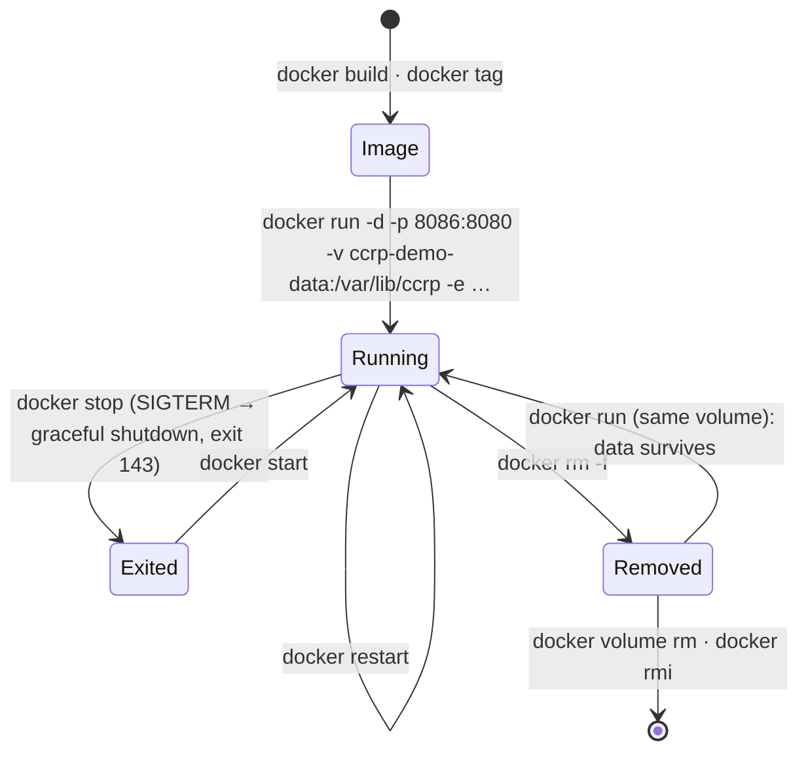
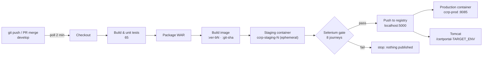

# 08 — Docker Image, Container Lifecycle and Continuous Deployment (Phases 11–12)

| Field | Value |
|---|---|
| Document ID | CCRP-DOC-08 |
| Version | 1.0 |
| Status | Approved |
| Owner | Tanishq |
| Last updated | 2026-10-11 |

## Contents

1. [Image design](#1-image-design)
2. [Image details](#2-image-details)
3. [Container lifecycle (Phase 11)](#3-container-lifecycle-phase-11)
4. [Commit-to-container pipeline (Phase 12)](#4-commit-to-container-pipeline-phase-12)
5. [Versioning and the registry](#5-versioning-and-the-registry)
6. [Production container deployment and automatic rollback](#6-production-container-deployment-and-automatic-rollback)
7. [Evidence](#7-evidence)
8. [Operations cheat sheet](#8-operations-cheat-sheet)

---

## 1. Image design

| Decision | Reason |
|---|---|
| **Build once, deploy many**: the image packages `target/*.war` instead of compiling inside Docker | The artefact that passed the unit tests is byte-for-byte the one that ships; no second build that could differ |
| Two stages: `layers` (extract) → runtime | The runtime image contains only the JRE and the application |
| Spring Boot **layers** (`-Djarmode=tools extract --layers`) | Dependencies (62.5 MB) change rarely; a code change rebuilds only the 590 kB `application` layer |
| `eclipse-temurin:21.0.12.1_1-jre-noble`, pinned | Reproducible builds; JRE, not JDK |
| Non-root `ccrp` (uid 10001) | Least privilege. Only `/var/lib/ccrp` is writable |
| `VOLUME /var/lib/ccrp` | H2 database and uploaded documents outlive containers |
| `HEALTHCHECK` on `/actuator/health/liveness` | Docker, the pipeline and the deploy script all use the same health signal |
| Exec-form `ENTRYPOINT` | The JVM is PID 1 and receives SIGTERM, so `docker stop` triggers a graceful shutdown |
| `-XX:MaxRAMPercentage=75` | Heap follows the container memory limit |
| OCI labels (`version`, `revision`, `created`, `source`) | Any running container can be traced to its commit |
| `.dockerignore` allow-list | Only the WAR is sent to the daemon: no `.git`, no secrets, a small context |

## 2. Image details

```text
$ docker image inspect getdocs-ccrp:1.2.0-SNAPSHOT
user=ccrp ports={"8080/tcp":{}} volumes={"/var/lib/ccrp":{}}
entrypoint=["java","org.springframework.boot.loader.launch.WarLauncher"]

$ docker history getdocs-ccrp:1.2.0-SNAPSHOT
590kB     COPY /build/extracted/application/ ./
4.1kB     COPY /build/extracted/snapshot-dependencies/
696kB     COPY /build/extracted/spring-boot-loader/ ./
62.5MB    COPY /build/extracted/dependencies/ ./
```

| Property | Value |
|---|---|
| Size | ~532 MB (Ubuntu Noble + Temurin JRE 21 ≈ 470 MB, app ≈ 64 MB) |
| Configuration | Environment variables only: `APP_ENVIRONMENT`, `APP_DATA_DIR`, `APP_OFFICER_PASSWORD`, `SERVER_PORT`, `JAVA_TOOL_OPTIONS` |

## 3. Container lifecycle (Phase 11)

`scripts/docker-lifecycle-demo.sh` performs and records every step: [docker-lifecycle.log](evidence/phase-11-docker/docker-lifecycle.log).



| Step | Command | Observed |
|---|---|---|
| Build | `docker build --build-arg VERSION=… --build-arg REVISION=… -t getdocs-ccrp:1.2.0-SNAPSHOT .` | 2-stage build |
| Tag | `docker tag … getdocs-ccrp:<sha>`, `…:latest` | 3 tags, same image ID |
| Run | `docker run -d --name ccrp-demo -p 8086:8080 -e APP_OFFICER_PASSWORD=… -v ccrp-demo-data:/var/lib/ccrp --restart unless-stopped` | `healthy` |
| Use | `curl /actuator/health`, submit an application | `UP`, tracking ID issued |
| Inspect | `docker logs`, `docker exec … id` (uid 10001), `docker stats` (≈ 436 MiB) | |
| Stop | `docker stop` | `Exited (143)`, log: *Graceful shutdown complete* |
| Start / restart | `docker start`, `docker restart` | `healthy` again |
| Remove + recreate | `docker rm -f` → `docker run` with the same volume | **The earlier request is still there** |
| Clean up | `docker rm -f`, `docker volume rm`, `docker rmi` | |

## 4. Commit-to-container pipeline (Phase 12)



Key properties:

- **The gate tests the image that ships.** Staging is a container started from the freshly built image, and that image is pushed only after the journeys pass.
- Staging containers are per-build (`ccrp-staging-<N>`, label `ccrp.ephemeral=true`) and are always removed in `post`.
- Production container and Tomcat deploy **in parallel**.
- Local images older than the newest six are pruned after each build; the registry keeps every version.

## 5. Versioning and the registry

| Tag | Example | Purpose |
|---|---|---|
| `<version>-b<build>` | `1.2.0-SNAPSHOT-b13` | Immutable, traceable to the Jenkins build |
| `git-<sha>` | `git-249c529` | Traceable to the commit |
| `latest` | | Moving pointer to the last image that passed the gate |

```text
$ curl -s http://localhost:5000/v2/getdocs-ccrp/tags/list
{"name":"getdocs-ccrp","tags":["1.2.0-SNAPSHOT-b12","1.2.0-SNAPSHOT-b13","git-249c529","latest"]}
```

The registry is `registry:3.1.2` in the CI stack (volume `registry_data`). Docker trusts `localhost` registries without TLS; a shared registry would need TLS and authentication. Docker Hub would need only a `docker login` with a Jenkins credential.

## 6. Production container deployment and automatic rollback

`scripts/deploy-container.sh <image> [name] [port]`:

1. Records the image of the running `ccrp-prod` (the rollback target).
2. Removes it and starts a **fresh** container from the new image (`--restart unless-stopped`, network `ccrp-ci`, port 8085, volume `ccrp-prod-data`, label `ccrp.deployed-by=<BUILD_TAG>`).
3. Waits for `healthy`. If the container is unhealthy or times out, it prints the logs, **restarts the previous image** and exits 1.

```text
==> Deploying localhost:5000/getdocs-ccrp:1.2.0-SNAPSHOT-b13 as ccrp-prod on :8085 (previous: …:1.2.0-SNAPSHOT-b12)
==> Healthy: localhost:5000/getdocs-ccrp:1.2.0-SNAPSHOT-b13 · started 2026-10-11T16:24:…
```

The automatic rollback is demonstrated in Phase 14 ([12-container-auto-rollback.log](evidence/phase-14-reliability/12-container-auto-rollback.log)).

## 7. Evidence

| Item | File |
|---|---|
| Container lifecycle log | [`phase-11-docker/docker-lifecycle.log`](evidence/phase-11-docker/docker-lifecycle.log) |
| Commit-to-container run | [`phase-12-container-cd/build-12-commit-to-container.log`](evidence/phase-12-container-cd/build-12-commit-to-container.log) |
| Fresh container replacing the previous one | [`build-13-replaces-running-container.log`](evidence/phase-12-container-cd/build-13-replaces-running-container.log) |
| Registry catalogue, tags, digest; `ccrp-prod` inspect | [`registry-and-production-container.txt`](evidence/phase-12-container-cd/registry-and-production-container.txt) |
| Pipeline stage graph and stage view | [`01-build-13-stages.png`, `02-pipeline-stage-view.png`](evidence/phase-12-container-cd/) |
| Production container serving the portal | [`03-production-container-8085.png`](evidence/phase-12-container-cd/03-production-container-8085.png) |

## 8. Operations cheat sheet

| Task | Command |
|---|---|
| Build locally | `./mvnw -DskipTests package && docker build -t getdocs-ccrp:local .` |
| Run locally | `docker run -d -p 8086:8080 -e APP_OFFICER_PASSWORD=ChangeMe123 -v ccrp-data:/var/lib/ccrp getdocs-ccrp:local` |
| What is in production | `docker inspect ccrp-prod --format '{{.Config.Image}} {{index .Config.Labels "org.opencontainers.image.revision"}}'` |
| Redeploy a known-good image | `OFFICER_PASSWORD=… scripts/deploy-container.sh localhost:5000/getdocs-ccrp:<tag>` |
| Registry contents | `curl -s localhost:5000/v2/getdocs-ccrp/tags/list` |
| Logs | `docker logs -f ccrp-prod` |
