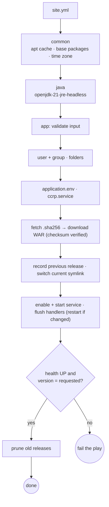

# 09 — Configuration Management with Ansible (Phases 13–14)

| Field | Value |
|---|---|
| Document ID | CCRP-DOC-09 |
| Version | 1.0 |
| Status | Approved |
| Owner | Tanishq |
| Last updated | 2026-10-11 |

## Contents

1. [Why Ansible](#1-why-ansible)
2. [Server prerequisites (configuration specification)](#2-server-prerequisites-configuration-specification)
3. [Project layout](#3-project-layout)
4. [Roles and playbooks](#4-roles-and-playbooks)
5. [Release layout and rollback model](#5-release-layout-and-rollback-model)
6. [Secrets](#6-secrets)
7. [The target node](#7-the-target-node)
8. [Phase 13: first execution](#8-phase-13--first-execution)
9. [Phase 14: provisioning, idempotency, health check, rollback and recovery](#9-phase-14--provisioning-idempotency-health-check-rollback-and-recovery)
10. [Commands](#10-commands)

---

## 1. Why Ansible

| Criterion | Ansible (chosen) | Puppet |
|---|---|---|
| Agent on the node | None, only SSH + Python | Puppet agent and a server/CA |
| Model | Ordered tasks in YAML, idempotent modules | Declarative catalog, pull model |
| Fit for a single-team MVP | Fast to adopt, easy to review in a PR | Better for very large fleets |

## 2. Server prerequisites (configuration specification)

| Category | Item | Value | Managed by |
|---|---|---|---|
| **OS** | Distribution | Ubuntu 24.04 LTS, systemd | node image |
| **Packages** | Base | `ca-certificates`, `curl`, `jq`, `tzdata` | `common` |
| | Runtime | `openjdk-21-jre-headless` (Java 21) | `java` |
| **Users / groups** | Service account | `ccrp:ccrp`, system user, shell `/usr/sbin/nologin`, home `/opt/ccrp` | `app` |
| | Automation account | `ansible`, SSH key only, passwordless sudo | node image |
| **Folders** | `/opt/ccrp` | root:ccrp 0755, application home | `app` |
| | `/opt/ccrp/releases/<x.y.z>/` | root 0755, one immutable WAR per release | `app` |
| | `/opt/ccrp/current` | symlink to the active release | `app` |
| | `/etc/ccrp` | root:ccrp 0750, configuration | `app` |
| | `/var/lib/ccrp` | ccrp:ccrp 0750, H2 database + uploaded documents (the only writable path) | `app` |
| **Files** | `/etc/ccrp/application.env` | root:ccrp **0640**: environment, data dir, port, officer password, JVM options | `app` (template) |
| | `/etc/systemd/system/ccrp.service` | 0644, service unit with hardening | `app` (template) |
| | `/opt/ccrp/.previous_release` | Version to return to on rollback | `app` |
| | `/etc/localtime`, `/etc/timezone` | Asia/Kolkata | `common` |
| **Ports** | 22/tcp | SSH (automation) | node |
| | 8080/tcp | Portal HTTP (published as host :8095 in the lab) | `app` |
| **Services** | `ssh.service` | enabled | node image |
| | `ccrp.service` | enabled, started, `Restart=on-failure` | `app` |
| **Verification** | Health | `GET /actuator/health` = `UP` | `app/healthcheck.yml` |
| | Version | `GET /actuator/info` `build.version` = requested version | `app/healthcheck.yml` |

`ccrp.service` hardening: `NoNewPrivileges`, `PrivateTmp`, `ProtectSystem=strict`, `ProtectHome`, `ReadWritePaths=/var/lib/ccrp`. `SuccessExitStatus=143` treats a graceful SIGTERM shutdown as success.

## 3. Project layout

```
infra/ansible/
├── ansible.cfg                       inventory, roles path, vault password file, SSH pipelining
├── inventory/
│   ├── hosts.ini                     [portal_nodes] ccrp-node-1 (127.0.0.1:2222)
│   └── group_vars/portal_nodes/
│       ├── vars.yml                  every tunable (version, paths, packages, port, heap)
│       └── vault.yml                 AES-256 encrypted secrets (ansible-vault)
├── site.yml                          provision + deploy (common → java → app)
├── rollback.yml                      return to the previous (or a given) release
├── healthcheck.yml                   read-only status, health and version check
├── roles/
│   ├── common/tasks/main.yml         apt cache, base packages, time zone
│   ├── java/tasks/main.yml           Java 21 runtime + version report
│   └── app/
│       ├── tasks/main.yml            user, folders, config, unit, release, service
│       ├── tasks/healthcheck.yml     health + version assertions (reused by every playbook)
│       ├── tasks/prune.yml           keep the newest N releases
│       ├── templates/                application.env.j2, ccrp.service.j2
│       ├── handlers/main.yml         reload systemd, restart ccrp
│       └── defaults/main.yml
└── node/Dockerfile                   the clean Ubuntu 24.04 + systemd target node
scripts/ansible.sh                    run a playbook with the project config
scripts/ansible-node.sh               create / recreate the clean node
```

## 4. Roles and playbooks



Every task uses an idempotent module (`apt`, `user`, `file`, `template`, `get_url` with checksum, `systemd_service`). Commands that only read are marked `changed_when: false`. Restarts happen only through handlers, so **a second run changes nothing**.

## 5. Release layout and rollback model

```
/opt/ccrp/
├── releases/
│   ├── 1.0.0/ccrp.war
│   └── 1.1.0/ccrp.war
├── current -> /opt/ccrp/releases/1.1.0
└── .previous_release            "1.0.0"
```

- Releases are downloaded from GitHub Releases (`v<x.y.z>/citizen-certificate-portal-<x.y.z>.war`) and verified against the published `.sha256` asset.
- Deploying a new version records the old one in `.previous_release`.
- `rollback.yml` points `current` at the previous release, swaps the two values (so a second rollback goes forward again), restarts, and runs the same health and version assertions.
- The data directory is outside the releases, so rollbacks never touch citizen data.

## 6. Secrets

- `vault.yml` is encrypted with **ansible-vault (AES-256)** and committed. The vault password is in `infra/ansible/.vault-pass`, which is git-ignored and readable only by the owner.
- The task that writes `application.env` sets `diff: false`, so the password never appears in output, even with `--diff`.
- New environment: `ansible-vault create inventory/group_vars/portal_nodes/vault.yml` with `vault_app_officer_password: "…"`.

## 7. The target node

A real VM would be the production equivalent. For the lab, `scripts/ansible-node.sh` starts a **clean Ubuntu 24.04 container that boots systemd** and contains only `openssh-server`, `python3` and `sudo`: no Java, no service user, nothing from the portal.

| Property | Value |
|---|---|
| SSH | `127.0.0.1:2222`, user `ansible`, key `infra/ansible/.ssh/id_ed25519` (generated, git-ignored) |
| Portal | http://localhost:8095 |
| Trade-off | Runs `--privileged` so systemd can manage cgroups inside Docker. Acceptable for a disposable lab node; use a VM in real environments |

## 8. Phase 13: first execution

`scripts/ansible.sh site.yml -e app_version=1.0.0` against the clean node: [log](evidence/phase-13-ansible/site-first-run.log)

```text
TASK [app : The running version is the one requested]
ok: [ccrp-node-1] => msg: ccrp-node-1 healthy · version 1.0.0 · commit df0f8cf · environment ansible-node

PLAY RECAP
ccrp-node-1 : ok=27  changed=14  unreachable=0  failed=0  skipped=2
```

## 9. Phase 14: provisioning, idempotency, health check, rollback and recovery

*Filled in by Phase 14 (see below).*

## 10. Commands

| Task | Command |
|---|---|
| Create a clean node | `scripts/ansible-node.sh --recreate` |
| Connectivity | `cd infra/ansible && ansible portal_nodes -m ping` |
| Dry run with diff | `scripts/ansible.sh site.yml --check --diff` |
| Provision / deploy a version | `scripts/ansible.sh site.yml -e app_version=1.1.0` |
| Only redeploy the app | `scripts/ansible.sh site.yml --tags app -e app_version=1.1.0` |
| Health and version | `scripts/ansible.sh healthcheck.yml` |
| Roll back to the previous release | `scripts/ansible.sh rollback.yml` |
| Roll back to a specific release | `scripts/ansible.sh rollback.yml -e rollback_to=1.0.0` |
| Service logs on the node | `ssh -p 2222 -i infra/ansible/.ssh/id_ed25519 ansible@127.0.0.1 journalctl -u ccrp -n 50` |
