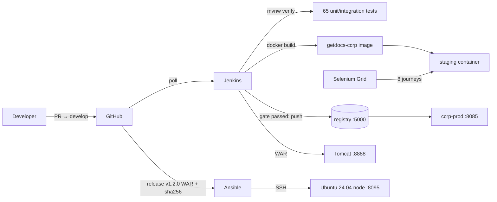

# 10 — Final Report: End-to-End Release, Troubleshooting, Limitations, Roadmap (Phase 15)

| Field | Value |
|---|---|
| Document ID | CCRP-DOC-10 |
| Version | 1.0 |
| Status | Final |
| Owner | Tanishq |
| Release | v1.2.0 |
| Last updated | 2026-10-11 |

## 1. Summary

All 15 MVP backlog items (CCR-1 … CCR-15) are delivered across three releases:

| Release | Content |
|---|---|
| v0.1.0 | Governance, planning documents, skeleton, design system |
| v1.0.0 | Citizen and officer workflows, certificates, audit trail, JSON API |
| v1.1.0 | Jenkins CI, Jenkinsfile + Tomcat, Selenium suite and quality gate |
| v1.2.0 | Docker image, container CD with registry and rollback, Ansible provisioning |

GitHub: 38 pull requests, 15 issues, 5 milestones, protected `main` and `develop`, tags `v0.1.0`–`v1.2.0`.

## 2. Architecture

## 3. End-to-end workflow run (v1.2.0)

| Step | Tool | Result | Evidence |
|---|---|---|---|
| Commit → PR → merge to `develop` | Git, GitHub | Reviewed PRs, merge commits | [docs/04](04-git-and-collaboration.md) |
| Build + 65 tests + coverage | Jenkins, Maven | Green, 90.5 % line coverage | [phase-12 log](evidence/phase-12-container-cd/build-12-commit-to-container.log) |
| Image → staging container → Selenium gate | Docker, Selenium Grid | 8/8 journeys pass | same |
| Push → production container + Tomcat | Registry, Docker, Tomcat Manager | Healthy, smoke tests pass | [registry evidence](evidence/phase-12-container-cd/registry-and-production-container.txt) |
| Release `v1.2.0` | GitHub Releases | WAR + SHA-256 published | [release](https://github.com/tanishqbuilds/citizen-certificate-portal/releases/tag/v1.2.0) |
| Provision / deploy node | Ansible | `failed=0`, *healthy · version 1.2.0* | [ansible log](evidence/phase-15-final/ansible-deploy-1.2.0.log) |

Final environment state ([final-environments.txt](evidence/phase-15-final/final-environments.txt)):

| Environment | URL | Version |
|---|---|---|
| Production container | http://localhost:8085 | 1.2.0-SNAPSHOT (latest develop build) |
| Tomcat production | http://localhost:8888/certportal-production | 1.2.0-SNAPSHOT |
| Ansible node | http://localhost:8095 | **1.2.0** (release) |

## 4. Quality results

| Check | Result |
|---|---|
| Unit + integration tests | 65 / 65 |
| Selenium journeys | 8 / 8 (6 journeys, TC-01 … TC-06) |
| Quality gate demo | Deliberate defect → build #7 failed, production untouched → fix → #8 green |
| Idempotency | `changed=0` on re-runs |
| Rollback | Ansible 1.1.0 → 1.0.0 with data preserved; container auto-rollback on a bad image |
| Recovery | systemd restarted a killed JVM in ~17 s |

## 5. Troubleshooting guide

| Symptom | Cause | Fix |
|---|---|---|
| `Cannot create a session after the response has been committed` | Deferred CSRF token on large pages | Already fixed (eager CSRF handler) |
| Tomcat: `NoClassDefFoundError …/WebServer` | `spring-boot-web-server` in `lib-provided` | Keep the explicit dependency in `pom.xml` |
| Jenkins job queued but never runs | Built-in node offline: disk < 1 GB | Free disk, then bring the node online (Manage Jenkins → Nodes) |
| First pipeline run deploys with empty env | Jenkinsfile parameters register after the first run | Parameters also in Job DSL (already done) |
| Jenkins build "terminated externally" | Controller restarted mid-build | Use *Safe Restart* |
| Selenium clicks ignored after login | Chrome password-breach bubble | Disabled in `DriverFactory` |
| Selenium `element click intercepted` | `scroll-behavior: smooth` | Removed |
| Officer login test fails only in CI | Env var `APP_OFFICER_PASSWORD` overrides test config | Test pins the property |
| `ccrp-tomcat` unhealthy | `curl -f /` returns 404 | Fixed health check |
| Contexts gone after recreating Tomcat | Writable layer | Named volumes (already done) |
| Ansible: `requires blocking IO` | Non-interactive shell | `scripts/ansible.sh` redirects stdin |
| App on node not starting | — | `journalctl -u ccrp -n 100` on the node; `scripts/ansible.sh healthcheck.yml` |

## 6. Limitations

- H2 file database. A single instance; no horizontal scaling.
- One officer account in memory; no roles hierarchy or user management.
- No rate limiting on `/track` (enumeration-safe, but not throttled).
- No email/SMS notifications, payments, e-KYC or DigiLocker integration (out of scope by design).
- Jenkins runs builds on the controller; registry without TLS/auth (lab only).
- The Ansible target is a privileged container, a stand-in for a VM.
- Queue capped at 200 rows (no pagination).

## 7. Future enhancements

1. PostgreSQL (Flyway migrations are already portable) and multiple app instances behind Nginx.
2. Officer accounts in the database, roles (reviewer/approver), password reset.
3. Notifications (email/SMS) on every status change.
4. Rate limiting (Bucket4j) and CAPTCHA on lookup and apply.
5. Jenkins agents, a TLS registry or Docker Hub, image scanning (Trivy) and dependency scanning as gates.
6. Observability: Prometheus metrics (Micrometer), Grafana, centralised logs.
7. Kubernetes manifests / Helm with rolling updates; Ansible for VM fleets.
8. DigiLocker/e-KYC integration and QR-code certificate verification.

## 8. Viva quick reference

| Question | Answer |
|---|---|
| Why Spring Boot + Maven? | The brief requires Maven/Gradle/Ant and Tomcat; one WAR runs on Tomcat, standalone and in Docker |
| How does the gate stop deployment? | Failsafe fails the stage, and declarative pipeline skips every later stage |
| What is "build once, deploy many"? | The tested WAR goes into the image; the tested image is pushed and deployed |
| How is idempotency shown? | Second `site.yml` run reports `changed=0` |
| How does rollback work? | Ansible: symlink to the previous release + health check. Docker: previous image restarted automatically |
| Where are secrets? | Jenkins credentials (JCasC from env), ansible-vault, git-ignored `ci/.env` |
